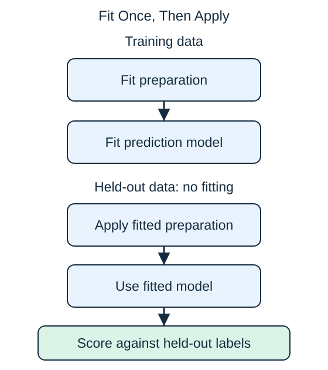

**Data leakage** occurs when training or model selection uses information that should not be available for the intended prediction. It can produce convincing scores for an unusable model.

For a prediction made at dispatch, "actual arrival time" leaks the answer. A less obvious feature, "refund issued for lateness," also comes from the outcome. Renaming it does not make it a valid input.

Leakage can enter preparation too. Suppose missing distances are filled with the average distance across the entire dataset before a split. The training process has now learned a little about the held-out examples. Instead, learn the replacement value from training data and reuse that value unchanged on validation, test, and future inputs.

The same rule applies to scaling and PCA. During cross-validation, fit preparation separately inside each training partition. Near-duplicate rows across training and test sets can also make a result misleading.

Ask two questions about every feature and fitted step: could we know this at prediction time, and did any held-out information influence learning? A suspiciously excellent score is a reason to inspect the pipeline before celebrating.

## Check your understanding

Can a refund issued after a delivery be used to predict lateness at dispatch?

**Answer:** No. It is unavailable at dispatch and reveals information about the later outcome.
