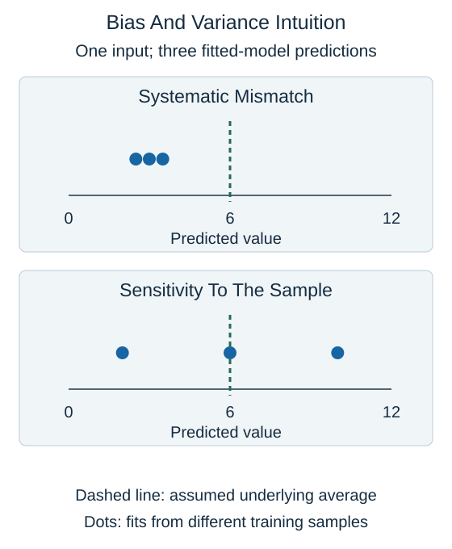

Imagine fitting the same modeling procedure to several different training samples from the same setting. For one fixed input, the predictions may be consistently wrong, highly variable, or both. This thought experiment helps distinguish bias from variance.

**Bias** concerns systematic mismatch: the average prediction across those possible training samples differs from the underlying average target for that input. A constant model can miss a genuine relationship between distance and duration even with many examples.

**Variance** concerns sensitivity: fitting on a different sample changes the prediction substantially. A very flexible model may follow unusual details of whichever sample it received.

Each mark in this schematic is a prediction from a separate fitted model, not a different input. The reference line is an assumed underlying average for explaining the idea. In real data that average is usually unknown, so one test set does not directly reveal a model's exact bias and variance.

Restricting flexibility can reduce variance but increase bias. Increasing flexibility can reduce some systematic mismatch while making predictions less stable. These are useful tendencies, not a guarantee that every algorithm follows a simple U-shaped error curve.

Some uncertainty remains even with a good model because the features do not determine the outcome exactly. Measurement noise or unobserved conditions can limit predictable accuracy. This statistical use of bias is distinct from sampling bias or unfair treatment, discussed later.

## Check your understanding

What does it suggest when predictions change greatly across comparable training samples?

**Answer:** High variance: the fitted result is sensitive to which training examples were used.
