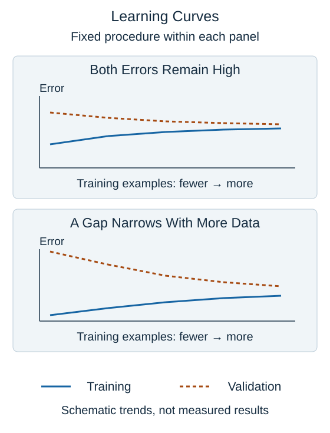

A **learning curve** compares performance at different training-set sizes while keeping the modeling procedure fixed. For each size, fit a model and measure training error and error on separate validation examples. Repeated suitable splits can reveal how variable the estimates are.

The horizontal axis is the number of training examples, not model complexity or training time. This distinguishes a learning curve from the earlier complexity diagram. Both figures use error on the vertical axis, so lower is better.

When training and validation errors remain high and close, adding similar examples alone may do little. The features may lack useful information, the model may be too restricted, or the labels may be noisy. Compare against a relevant baseline before deciding that an error is high.

When training error is low but validation error is larger, there is a generalization gap. If that gap narrows as training size increases, collecting more representative data may help. Regularization or a less flexible model is another possibility to compare on validation data.

These are diagnostic clues, not automatic prescriptions. A gap can also reflect distribution differences, and leakage can make validation look deceptively good. Real curves fluctuate. Keep preparation inside each training split and respect time or group boundaries; do not reuse the final test set as the plotted validation set while making decisions.

## Check your understanding

Does a learning curve vary the number of model layers on its horizontal axis?

**Answer:** No. It varies the amount of training data for a fixed modeling procedure.
