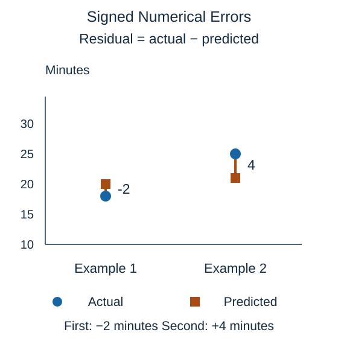

For regression, compare each prediction with its observed target before summarizing errors. A **residual** is the observed value minus the prediction. The term is often used for fitted training examples; we use the same subtraction for errors on held-out examples.

$$
r=y-\hat{y}
$$

Here $r$ is the signed difference, $y$ is the observed target, and $\hat{y}$ is the prediction. The hat marks an estimate. Positive $r$ means the prediction was too low; negative $r$ means it was too high.

For an actual time of 18 minutes and a prediction of 20, $r=18-20=-2$ minutes. For an actual time of 25 and a prediction of 21, $r=25-21=4$ minutes. The first prediction is two minutes too high; the second is four minutes too low.

The signs are useful when checking whether a model tends to overpredict or underpredict. Their magnitudes describe how far off the predictions are. Simply averaging signed differences lets opposite errors cancel: predictions two minutes too high and two minutes too low have an average signed error of zero, despite both being wrong.

A residual plot places a signed difference against an input or prediction. A visible trend can suggest missed structure, and a wider spread in one region suggests less consistent errors there. These patterns support investigation; they do not identify a unique cause by themselves. The next lessons summarize magnitudes without cancellation.

## Check your understanding

With the convention $r=y-\hat{y}$, what does a positive residual mean?

**Answer:** The observed value exceeds the prediction, so the model underpredicted.
