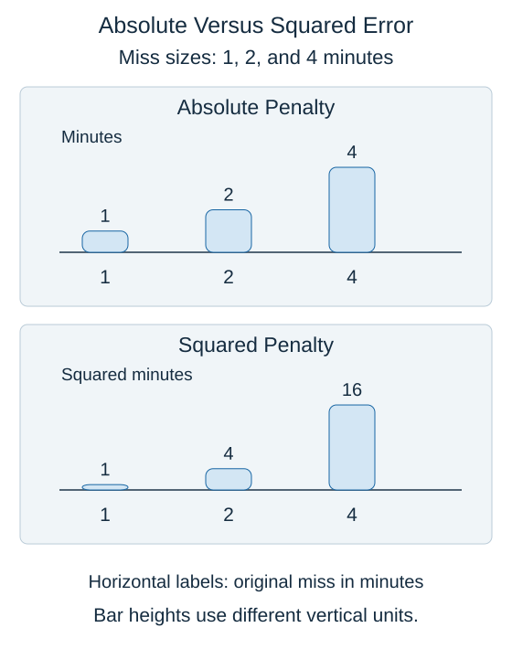

**Mean squared error**, or MSE, squares each numerical miss before averaging. Squaring removes the sign and gives larger misses more influence than smaller ones.

For two predictions with residuals $r_1$ and $r_2$:

$$
\text{MSE}=\frac{r_1^2+r_2^2}{2}
$$

Each $r$ is an observed value minus its prediction; subscripts 1 and 2 identify the examples. The exponent 2 means multiply the residual by itself. For residuals of $-2$ and $4$ minutes, MSE is $(4+16)/2=10$ squared minutes.

The chart compares penalties, not two scores in the same physical units. A four-minute miss contributes 4 minutes to the absolute-error sum but 16 squared minutes to the squared-error sum. Squared error makes an occasional large miss relatively more influential.

**Root mean squared error**, or RMSE, takes the square root after averaging:

$$
\text{RMSE}=\sqrt{\text{MSE}}
$$

The square-root sign means the nonnegative value whose square gives MSE. For MSE of 10 squared minutes, RMSE is approximately 3.16 minutes. MAE for the same pair is 3 minutes. Both return a useful summary, but neither describes every example's error.

Choose a measure that reflects the task, and inspect unusual misses separately. MAE is less affected by extreme errors than MSE, but it is not immune to them. A model that improves one measure may worsen another. Compare candidates on the same evaluation examples.

## Check your understanding

If a miss increases from 2 to 4 minutes, how does its squared-error contribution change?

**Answer:** It rises from 4 to 16 squared minutes, four times as much.
