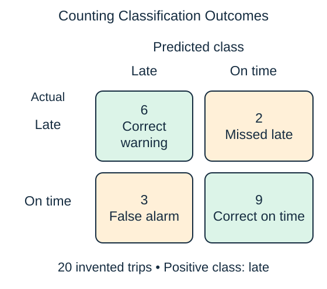
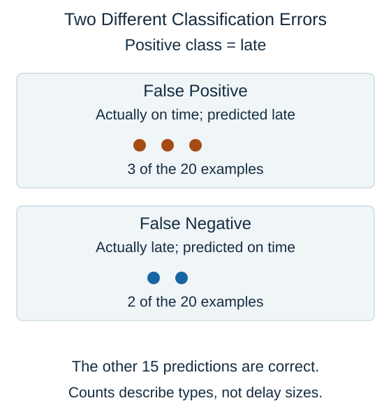

For a late-trip classifier, call "late" the positive class. **Positive** names the class of interest; it does not mean good. A confusion matrix counts predictions against observed answers.

A true positive is a late trip correctly flagged. A false positive is an on-time trip incorrectly flagged, or a false alarm. A false negative is a late trip the model misses. A true negative is an on-time trip correctly left unflagged.

$$
\begin{aligned}
\text{accuracy}&=\frac{\text{correct predictions}}{\text{all predictions}}\\
&=\frac{6+9}{20}=0.75
\end{aligned}
$$

Accuracy is the fraction of all predictions that are correct. In this invented set it is 0.75, or 75%. The numerator counts both kinds of correct decision; the denominator counts every trip once.

Always read the axis labels. Some tools put actual classes in rows and others in columns. Our figure uses actual classes in rows. The four counts tell us more than accuracy alone: there are three unnecessary warnings and two missed delays, which may have different costs.

The circles isolate the two error groups from the matrix. The remaining 15 predictions are correct. Each circle counts one example; its position does not measure how many minutes late it was.

False positives and false negatives are classification outcomes, not positive and negative numerical residuals. In the matrix, a missed late delivery is a false negative regardless of how many minutes late it was. A separate regression target would be needed to measure the size of the delay.

## Check your understanding

In this figure, what is a false negative?

**Answer:** One of the two trips that was actually late but was predicted on time.
