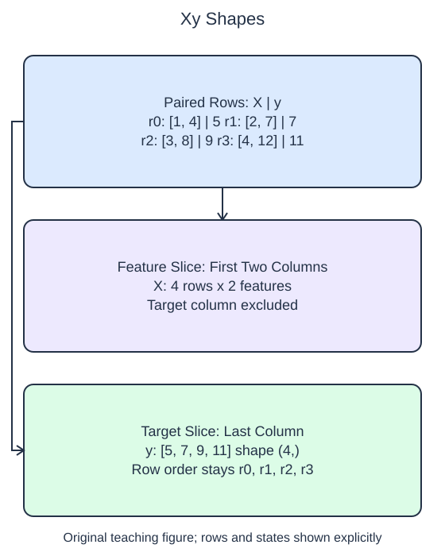

# Arrange features and targets

Start with one package per row. Its weight, volume, and handling cost belong together, even after you separate inputs from the value to predict. This small synthetic HomeHurray Inc. table lets you see a broken pairing before it reaches a model.

Scikit-learn conventionally calls the inputs `X` and the target `y`. The capital letter is a naming convention, not special Python syntax. `X` has one row per sample and one column per feature. For one numeric target, `y` has one value per sample. A target is the quantity the model will learn to predict; including it among the inputs would give the model an answer it will not have for a new observation.

NumPy slicing makes this distinction visible. `records[:, :2]` keeps every row and the first two columns. The slice preserves a column axis. By contrast, `records[:, 2]` selects one column by its integer position and returns a vector. The supplied `.copy()` calls make independent arrays; copying is not what gives them their shapes.

The initial program deliberately includes only weight in `X`. It runs and prints a valid matrix, but it does not satisfy this lesson's two-feature schema. After the edit, inspect both shapes and the first paired row rather than judging success from a printed number alone. A shape check can detect a missing column; checking the paired values also catches accidental sorting or row reversal.

A one-feature problem would still need a matrix such as `records[:, :1]`, with shape `(n, 1)`, rather than a length-`n` vector. This distinction becomes useful when you fit the first estimator.

## Worked calculation

For $n$ samples and $p$ features, the shapes are

$$
X\in\mathbb{R}^{n\times p},\qquad y\in\mathbb{R}^{n}.
$$

Here $n=4$ and $p=2$: `X.shape` is `(4, 2)` and `y.shape` is `(4,)`. Shape entries count rows and columns; they are not measurement units.

## Data used here

`records[:, 0]`: float package weight in kg; `records[:, 1]`: float packaged volume in liters; both measured before handling. `records[:, 2]`: float handling cost in USD, the later target. Row position is an alignment key, not a predictor. No values are missing.

## Small edit

Change the feature slice from `:1` to `:2`.

Edit `main.py`, press Run to inspect the supplied probe, then Submit to check the behavior.

## Your Tasks

1. Return `(X, y)` from `make_xy(records)`: the first two columns form a two-dimensional feature matrix and the last column forms a one-dimensional target, in the original row order.
