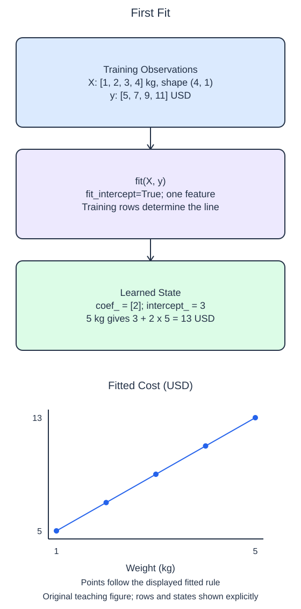

# Fit an estimator

Creating an estimator and fitting it are different operations. `LinearRegression(...)` creates an object with settings. It has not yet learned how package weight relates to handling cost. `model.fit(X_train, y_train)` uses the paired training observations to estimate that relationship.

The `fit_intercept` setting decides whether the fitted line may have a nonzero intercept. With `True`, the line can cross the vertical axis above or below zero. With `False`, the model is forced through the origin. A zero intercept is a substantive assumption, not a shortcut for ignoring small costs. This toy handling table has a fixed cost even before the per-kilogram contribution, so an intercept is appropriate. `n_jobs=1` requests a single job where the estimator can use that setting.

After fitting, inspect `coef_` and `intercept_`. Scikit-learn uses a trailing underscore for many learned attributes. `coef_` has one value per input feature for this single-target problem, while `intercept_` is a scalar. The constructor setting `fit_intercept` has no trailing underscore because you choose it before the observations are fitted.

The starter already fits a line, but it forces the intercept to zero. Run once to see the resulting coefficient. Make the small edit, then Run again: the new coefficient and intercept describe a different fitted line. The data happen to lie exactly on a line so you can inspect the arithmetic without noise.

These are training-only observations for learning the interface. Recovering their pattern does not demonstrate accurate predictions on unseen packages. Holdout evaluation comes after the estimator methods are familiar; do not report this exact fit as evidence of business performance.

## Worked calculation

For one feature, $\hat y=b+wx$, where $x$ is weight in kg, $w$ is cost per kg, $b$ is fixed cost in USD, and $\hat y$ is predicted cost in USD. The fitted demo has $w=2$ and $b=3$.

$$
\hat y=3+2(5)=13\text{ USD}.
$$

This is the line's prediction for a 5 kg package, not a measured outcome.

## Data used here

`X_train`: float package weight in kg, measured before handling; `y_train`: float handling cost in USD observed afterward. Each row is one synthetic package. No missing values or ID predictors are present.

## Small edit

Change `fit_intercept=False` to `fit_intercept=True`.

Edit `main.py`, press Run to inspect the supplied probe, then Submit to check the behavior.

## Your Tasks

1. Fit and return a `LinearRegression` with `fit_intercept=True` and `n_jobs=1`, using only the helper arguments `X_train` and `y_train`.
