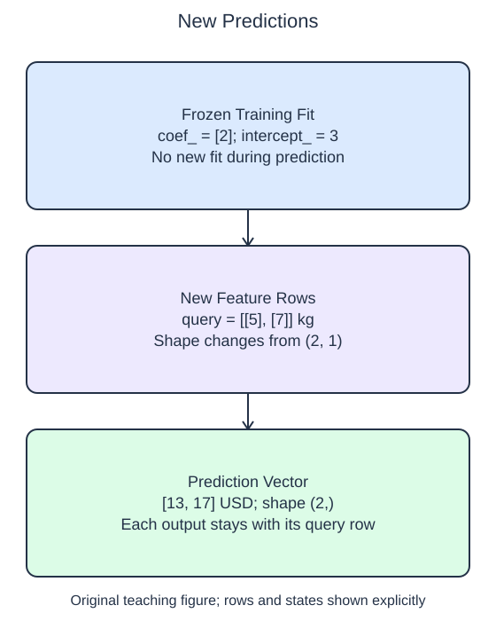

# Predict new rows

Prediction uses a fitted estimator with new feature rows. The supplied setup fits the same small package model as before. Your helper receives that model and a query matrix; it does not receive query targets, because those are the values being estimated.

`model.predict(query)` returns one prediction for each row of `query`, in the same order. A two-row, one-feature query therefore has shape `(2, 1)`, and its prediction vector has shape `(2,)`. The double brackets in `[[5.], [7.]]` are deliberate: they describe two samples with one feature each. A flat array would not express the matrix contract expected here.

New rows must use the same feature meaning and column order as the training rows. A model trained on kilograms cannot detect that a caller silently supplied pounds. With several features, swapping columns can produce plausible-looking but meaningless numbers even when the overall shape is valid. Schema agreement is separate from arithmetic agreement.

The starter currently predicts only the first query row. Its output is finite, so merely checking that Run succeeds would miss the error. Compare the number of query rows with the number of returned predictions, then remove the limiting slice. The printed vector should now include the second estimate.

Calling `predict` reuses the learned coefficient and intercept. Calling `fit` again would replace that learned relationship and would require targets. This helper should leave the fitted model unchanged. The query weights extend beyond the tiny training range, which makes the line's extrapolation visible; it does not establish that the same linear relationship is valid for heavier real packages.

## Data used here

`X_train` and `query`: float package weights in kg available before handling; `y_train`: observed float handling costs in USD. Query outcomes are unknown and are not supplied. Values are complete.

## Small edit

Remove the `[:1]` slice so prediction includes the whole query matrix.

Edit `main.py`, press Run to inspect the supplied probe, then Submit to check the behavior.

## Your Tasks

1. Return `model.predict(query)` for every row of the two-dimensional query matrix without fitting the model again.
