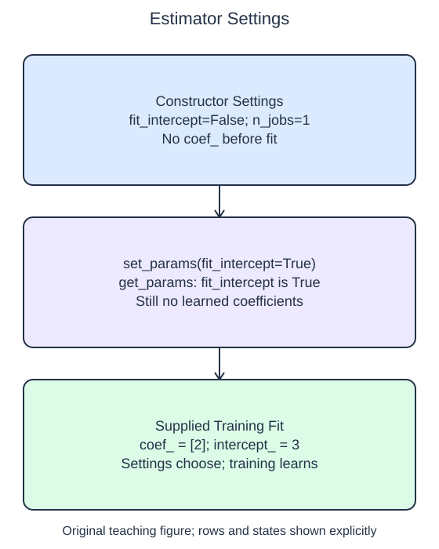

# Inspect estimator settings

An estimator's configuration is available separately from its learned state. `get_params()` returns a dictionary of constructor settings. Looking up `get_params()["fit_intercept"]` tells you what a future fit is configured to do; it does not tell you what intercept a previous fit learned.

`set_params(fit_intercept=True)` changes a named setting on the existing object and returns that object. It is useful when configuration is chosen after construction. You do not need to create a replacement estimator just to change one setting, and replacing it could discard other choices that the caller already made.

The starter creates a model with intercept fitting disabled. Your helper makes one configuration change. The supplied probe then prints the setting and fits the data, in that order. This ordering keeps configuration and learning distinct. The helper should not secretly fit its own data, because the caller is responsible for deciding which observations belong in training.

A fitted model can also accept `set_params`, but changing a setting does not automatically recompute its learned coefficients. To obtain learned state consistent with a changed training setting, fit again on the intended training data. Do not read an old `intercept_` and assume it was recalculated by configuration alone.

Observe the two different kinds of output: a Boolean setting and a numeric learned intercept. They answer different questions. The setting says whether fitting may learn an intercept; the numeric attribute records the value obtained from the specific observations. This small distinction becomes important when later lessons compare model settings while protecting the final test set.

## Data used here

`X_train`: float package weight in kg known before handling; `y_train`: later float handling cost in USD. The table is complete, with one package per row.

## Small edit

Change the value passed to `set_params` from `False` to `True`.

Edit `main.py`, press Run to inspect the supplied probe, then Submit to check the behavior.

## Your Tasks

1. Use `set_params` to enable `fit_intercept` on the supplied estimator and return that same estimator without fitting it or changing its other settings.
