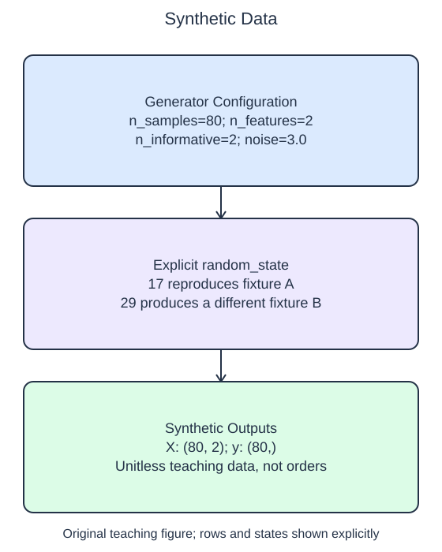

# Generate controlled datasets

A synthetic fixture lets you control a problem's size and randomness without presenting invented rows as observations. `make_regression` creates a feature matrix and a continuous target vector. Here `n_samples` sets the row count, `n_features` sets the column count, and `n_informative` says how many feature columns contribute to the generated target. `noise=3.0` adds target noise with that standard deviation in the generator's arbitrary units.

`random_state` controls the pseudo-random choices. Passing the same integer with the same settings reproduces the arrays. Passing a different seed changes them. A seed is useful for repeatable debugging, but one repeatable fixture does not establish that a method works well across different populations.

The starter accepts a seed argument but ignores it inside the generator. Its visible call asks for seed 29 while the implementation uses 17. Run once, correct the argument, and Run again to inspect the changed first targets. Repeating that corrected run should reproduce the new result.

The exercise uses `make_classification`, which returns discrete class labels instead. It also accepts `n_samples`, `n_features`, `n_informative`, and `random_state`. Set `n_redundant=0` to avoid extra columns constructed as combinations of the informative columns. With three total features and two informative features, the remaining feature is noise. `n_classes=2` requests labels 0 and 1.

Both generators are teaching tools. Their numeric values have no automatic kilogram, dollar, or probability interpretation. We label the arrays synthetic and leave them unitless rather than pretending that a convenient generated classification problem is measured return behavior. Keeping these fixtures small makes their shapes and repeatability easy to inspect before introducing more realistic table schemas.

## Data used here

`X`: two float, unitless synthetic feature columns; `y`: float unitless synthetic regression target. The generator creates complete independent rows for an artificial stationary snapshot labeled 2025-01-15. The feature/target relationship is generated, not measured, and no actual commercial quantities or IDs are represented.

## Small edit

Replace the fixed `random_state=17` with `random_state=seed`; the supplied call uses seed 29 to reveal the change.

Edit `main.py`, press Run to inspect the supplied probe, then Submit to check the behavior.

## Your Tasks

1. Make `generate(seed, n_rows)` return `make_regression` data with `n_rows` samples, two features, two informative features, noise `3.0`, and `random_state=seed`.
