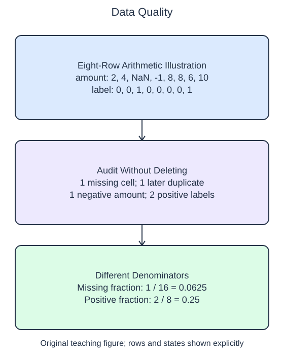

# Audit a feature table

Before fitting anything, describe the table's defects. An audit should report what it sees without deciding that every unusual row must be deleted. A negative package weight is invalid under this schema; a repeated row could be a duplicate record or two genuinely equal measurements. Those require different follow-up decisions.

## Dataset

**Row grain:** one synthetic package inspection record. **Files:** `observations.csv` (32 rows).

| Column | Meaning | Type / unit | Role / availability |
| --- | --- | --- | --- |
| `amount` | Package weight | float; kg | Known before handling |
| `label` | Inspection flag | integer; 0/1 | Later outcome; audit/stratification only |

Original synthetic HomeHurray Inc. teaching data; no actual customer records or measured business-performance claims. An empty numeric CSV cell means not recorded, not zero; pandas reads it as NaN. Deliberate repeated rows and negative amounts are audit defects; do not delete them automatically. The figure uses the explicitly labeled eight-row illustration; the files contain the larger runnable dataset. Training, validation, and query filenames describe supplied membership, not predictor columns.

## Worked explanation

The helper returns four named measurements. `missing_fraction` counts missing cells across the whole table and divides by the total number of cells. `table.isna()` creates a Boolean table, summing twice counts its `True` entries, and `table.size` counts every cell. A raw missing count is not a fraction, so its meaning changes when the table grows.

`duplicate_rows` uses `duplicated().sum()`. By default, `duplicated` marks repeated complete rows after their first occurrence. This is not a count of all rows in duplicate groups. `invalid_amounts` counts negative values in the amount column; missing amounts are reported separately, not silently treated as negative. `positive_fraction` is the mean of the complete binary target column, since every 1 contributes one and every 0 contributes zero.

Run the starter and inspect its missing measurement. The 32-row file contains one missing cell among 64 cells. The figure below isolates the original eight-row example for a shorter calculation. Correct that denominator while leaving the other audit entries and the source table intact. A compact dictionary makes these checks inspectable without mixing them with an automatic cleanup policy.

Class imbalance is a description, not proof that a dataset is unusable. Likewise, a missing fraction alone does not reveal whether missingness is concentrated in one feature or one group. This small audit is an initial check; later preprocessing lessons show explicit replacement policies learned from training data only.

The supplied setup reads `observations.csv` (32 rows). Open the read-only data tabs to inspect the records; edit only `main.py`. `pd.read_csv` reads the actual CSV file into a DataFrame; selecting named columns and calling `to_numpy()` gives the arrays used by the estimator. Empty numeric cells become NaN. Inspect `table.shape` for row/column counts, `table.columns` for names, and `table.dtypes` for parsed types. A DataFrame keeps that schema visible while the audit works on cells. 

## Worked calculation

Let $m$ be the number of missing cells and $c$ the total cell count. The missing fraction is $f=m/c$. For the separate eight-row, two-column illustration,

$$
f=\frac{1}{8\times2}=0.0625.
$$

This means 6.25% of cells, not 6.25% of rows, are missing.

## Small edit

Divide the missing-cell count by `table.size` in `missing_fraction`.

Edit `main.py`, press Run to inspect the supplied probe, then Submit to check the behavior.

## Your Tasks

1. Return the four-entry audit dictionary described above without modifying the table: missing-cell fraction, repeated full-row count after the first copy, negative amount count, and label-1 fraction.
