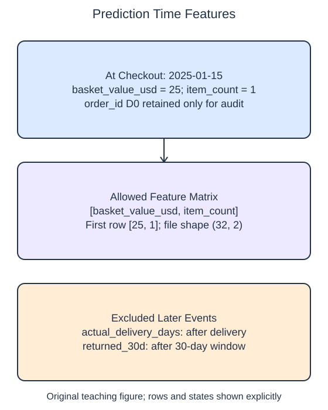

# Exclude unavailable features

A feature can be numeric, complete, and strongly related to the target yet still be unavailable when prediction is needed. This table describes a return-prediction task at checkout. Basket value and item count already exist then. Actual delivery duration does not: the package has not been delivered.

## Dataset

**Row grain:** one independent synthetic checkout. **Files:** `observations.csv` (32 rows).

| Column | Meaning | Type / unit | Role / availability |
| --- | --- | --- | --- |
| `order_id` | Checkout identifier | string | Audit only; never a predictor |
| `basket_value_usd` | Basket total | float; USD | Input available at checkout |
| `item_count` | Items in the basket | integer; count | Input available at checkout |
| `actual_delivery_days` | Observed delivery duration | integer; days | Later information; excluded at checkout |
| `returned_30d` | Returned within 30 days | integer; 0/1 | Target; available after outcome window |

Original synthetic HomeHurray Inc. teaching data; no actual customer records or measured business-performance claims. These files have complete values; no missing-value sentinel is present. Checkouts are dated 2025-01-15; 30-day outcomes are observed by 2025-02-15. Training, validation, and query filenames describe supplied membership, not predictor columns.

## Worked explanation

Define the prediction moment before selecting columns. A later warehouse export can place checkout measurements and outcome fields next to each other, but proximity in a DataFrame does not make them equally valid inputs. If a model learns from delivery duration and then must predict at checkout, its training inputs do not match its intended use.

Use an explicit allowlist for the feature schema. `table[["basket_value_usd", "item_count"]]` chooses the known columns in a fixed order. Selecting every column except the target is unsafe: it can retain IDs, target proxies, or future columns added by another export. An order ID helps track rows, but arbitrary identifier text is not one of this task's predictors.

The starter's selection includes actual delivery days. It runs because the field is present in the historical table. Replace that field with item count and inspect the printed column names. This is a schema correction, not a missing-data correction; no imputation method can make a genuinely future measurement available earlier.

The binary label means a return within thirty days. In this fixture the labels are observed after that window, while the allowed inputs remain the checkout snapshot. We do not infer real return behavior from these invented rows. The exercise adds a return-reason field to show why allowing only named inputs is safer than trying to enumerate every forbidden field.

The supplied setup reads `observations.csv` (32 rows). Open the read-only data tabs to inspect the records; edit only `main.py`. `pd.read_csv` reads the actual CSV file into a DataFrame; selecting named columns and calling `to_numpy()` gives the arrays used by the estimator. Empty numeric cells become NaN. 

## Small edit

Replace `actual_delivery_days` in the selected columns with `item_count`.

Edit `main.py`, press Run to inspect the supplied probe, then Submit to check the behavior.

## Your Tasks

1. Return a DataFrame containing only `basket_value_usd` and `item_count`, in that order and with the original row index; exclude identifiers, later outcomes, and any extra columns.
