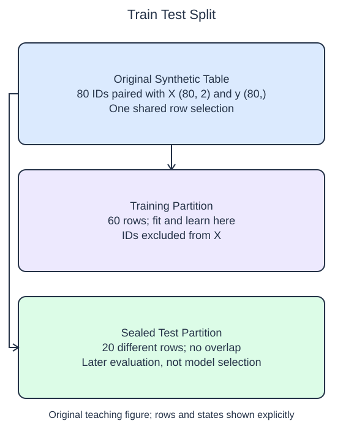

# Create a held-out test set

A held-out test set gives you observations that did not participate in training. Split rows before fitting a model or learning preprocessing statistics. The tiny earlier examples only taught estimator methods; now the row boundary becomes part of the workflow.

## Dataset

**Row grain:** one independent generated observation. **Files:** `observations.csv` (80 rows).

| Column | Meaning | Type / unit | Role / availability |
| --- | --- | --- | --- |
| `row_id` | Original row identifier | integer; unitless | Audit/split alignment only; excluded from X |
| `feature_0` | Generated feature 0 | float; unitless | Input; original column order |
| `feature_1` | Generated feature 1 | float; unitless | Input; original column order |
| `target` | Generated regression outcome | float; unitless | Target; excluded from X |

Synthetic make_regression export: 80 samples, 2 features (all informative), noise=3, random_state=17. These are generated observations, not measured HomeHurray Inc. records. These files have complete values; no missing-value sentinel is present. Training, validation, and query filenames describe supplied membership, not predictor columns.

## Worked explanation

`train_test_split` accepts several aligned arrays and applies the same row selection to all of them. With `ids`, `X`, and `y` as arguments, it returns six arrays: training IDs, test IDs, training features, test features, training targets, and test targets. Each input contributes its training output followed by its test output. The order is worth reading carefully before unpacking.

`test_size=0.25` reserves a quarter of these evenly divisible fixtures for testing. `random_state=17` makes the shuffled assignment repeatable. The seed does not make the split representative by itself; it only makes the particular random choice reproducible. Supplying the IDs lets you verify that no row appears in both partitions without putting identifiers into the predictors.

Run the starter and inspect its two counts. It currently reserves half the table. Change the fraction and confirm that the counts change while still adding to the full row count. The splitting function receives all arrays together, so a shuffled feature row remains paired with its own target.

This demonstration assumes independent rows from the same stationary synthetic population. Random row splitting does not answer every evaluation question. Repeated observations of one customer can appear in both sets, and shuffled future records can enter training. Later lessons use group and time boundaries for those cases. For now, keep the final test set aside rather than repeatedly consulting its targets while making choices.

The supplied setup reads `observations.csv` (80 rows). Open the read-only data tabs to inspect the records; edit only `main.py`. `pd.read_csv` reads the actual CSV file into a DataFrame; selecting named columns and calling `to_numpy()` gives the arrays used by the estimator. Empty numeric cells become NaN. 

## Small edit

Change `test_size=0.5` to `test_size=0.25`.

Edit `main.py`, press Run to inspect the supplied probe, then Submit to check the behavior.

## Your Tasks

1. Return the six outputs of one `train_test_split(ids, X, y, ...)` call with `test_size=0.25` and `random_state=17`, preserving paired row values.
