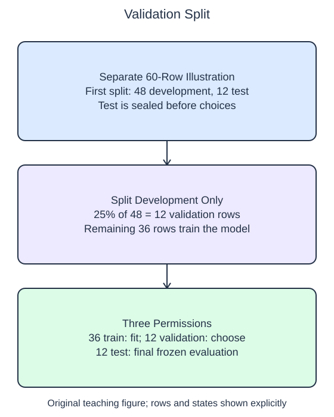

# Reserve validation data

Choosing a setting is itself a use of data. If you repeatedly compare models on the final test set and keep the best one, that set has helped select the model. Reserve a separate validation partition for such choices so the final test can remain untouched until the workflow is frozen.

## Dataset

**Row grain:** one independent generated observation. **Files:** `observations.csv` (80 rows).

| Column | Meaning | Type / unit | Role / availability |
| --- | --- | --- | --- |
| `row_id` | Original row identifier | integer; unitless | Audit/split alignment only; excluded from X |
| `feature_0` | Generated feature 0 | float; unitless | Input; original column order |
| `feature_1` | Generated feature 1 | float; unitless | Input; original column order |
| `target` | Generated regression outcome | float; unitless | Target; excluded from X |

Synthetic make_regression export: 80 samples, 2 features (all informative), noise=3, random_state=17. These are generated observations, not measured HomeHurray Inc. records. These files have complete values; no missing-value sentinel is present. Training, validation, and query filenames describe supplied membership, not predictor columns.

## Worked explanation

A two-stage split makes a 60%/20%/20% allocation. First reserve 20% of the full table as test. The remaining 80% is the development portion. Next reserve 25% of that development portion as validation. A fraction in `train_test_split` applies to the array passed to that call, not to the original table.

The helper operates on IDs only. In the supplied example the IDs are row positions, so the caller can use `X[train]` and `y[train]` to select aligned training values. Returning the ID partitions also makes disjointness easy to inspect before any model is fitted. For arbitrary business identifiers, a lookup rather than direct positional indexing would be needed.

The starter uses 20% in both calls. That does not create a validation partition equal to 20% of the original table. Correct the second fraction and inspect the printed counts. Both calls use the same explicit integer seed for reproducibility; the second call still acts on a different input array.

Training rows learn parameters and preprocessing state. Validation rows compare choices using already fitted state. The sealed test rows support one final report after choices are fixed. These are permissions, not merely names assigned to three arrays. Renaming a repeatedly inspected test set does not undo its influence on selection.

All rows here are independent stationary synthetic observations. This split illustrates a same-population protocol rather than a forecast of future business conditions.

The supplied setup reads `observations.csv` (80 rows). Open the read-only data tabs to inspect the records; edit only `main.py`. `pd.read_csv` reads the actual CSV file into a DataFrame; selecting named columns and calling `to_numpy()` gives the arrays used by the estimator. Empty numeric cells become NaN. 

## Worked calculation

Let $n$ be the original row count; $n_{test}$, $n_{val}$, and $n_{train}$ count test, validation, and training rows. Validation gets $0.25(0.80n)=0.20n$ rows when these products are integers. For a separate 60-row illustration,

$$
n_{test}=12,\quad n_{val}=12,\quad n_{train}=36.
$$

The visible 80-row demo instead produces 48, 16, and 16 rows. Fractions are dimensionless; all three counts refer to samples.

## Small edit

Change the second split's `test_size` from `0.2` to `0.25`.

Edit `main.py`, press Run to inspect the supplied probe, then Submit to check the behavior.

## Your Tasks

1. Return train, validation, and test IDs using two seeded splits: reserve 20% as test first, then reserve 25% of the remaining development IDs as validation; use `random_state=17` in both calls.
