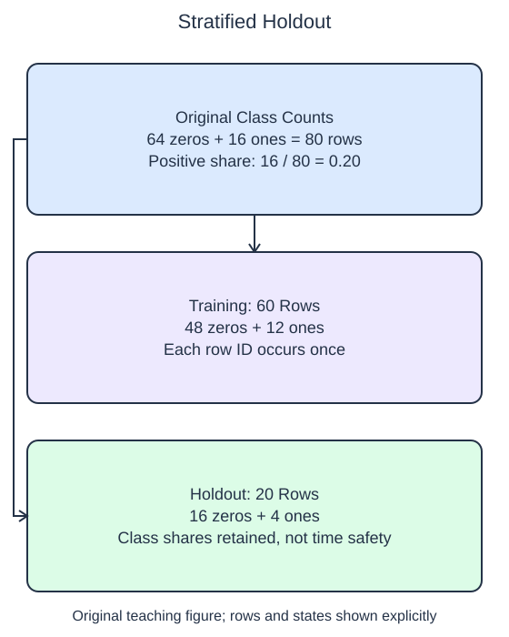

# Preserve class representation

A small random holdout can contain a different class mix from the table it came from. Stratification allocates rows by class so the partitions approximately retain the original shares. In this fixture the counts divide evenly, so the requested shares can be preserved exactly.

## Dataset

**Row grain:** one independent synthetic checkout. **Files:** `labels.csv` (80 rows).

| Column | Meaning | Type / unit | Role / availability |
| --- | --- | --- | --- |
| `row_id` | Original row identifier | integer; unitless | Audit/split alignment only; excluded from X |
| `label` | Return flag | integer; 0/1 | Later outcome; audit/stratification only |

Original synthetic HomeHurray Inc. teaching data; no actual customer records or measured business-performance claims. These files have complete values; no missing-value sentinel is present. Training, validation, and query filenames describe supplied membership, not predictor columns.

## Worked explanation

Pass the aligned target vector as `stratify=labels` in `train_test_split`. The returned objects are still the ID partitions, because IDs are the array being split. The labels guide the assignment but are not inserted into the output IDs or into a feature matrix. `random_state=17` makes the within-class assignment reproducible.

The supplied program prints class counts with `np.bincount`, which counts occurrences of nonnegative integer labels. The order here is count for class 0, then count for class 1. Run the unstratified starter first, add the argument, and compare the counts. A partition with a large majority of zeros can look superficially balanced by size while having too few positive examples for a meaningful comparison.

Stratification has limits. Each class needs enough rows to appear in both partitions, and each partition must have room for all classes. A class represented by one row cannot be divided honestly. Let the splitter report that error instead of duplicating the lone observation into both sets or silently abandoning stratification. In a real study, collect more data or reconsider the evaluation design.

Preserving class shares does not prevent leakage between repeated customers, products, or future periods. It only addresses the class-count allocation for this random split. The demonstration assumes independent synthetic checkouts, not repeated entities. Group and temporal evaluation need their own boundaries even when their resulting class shares are less convenient.

The supplied setup reads `labels.csv` (80 rows). Open the read-only data tabs to inspect the records; edit only `main.py`. `pd.read_csv` reads the actual CSV file into a DataFrame; selecting named columns and calling `to_numpy()` gives the arrays used by the estimator. Empty numeric cells become NaN. 

## Worked calculation

For class $c$, let $n_c$ be its row count and $n$ the total. Its share is $p_c=n_c/n$. The demo's positive share is

$$
p_1=\frac{16}{80}=0.20.
$$

A 20-row holdout therefore contains 4 positives and 16 negatives under the requested stratification.

## Small edit

Add `stratify=labels` to the split call.

Edit `main.py`, press Run to inspect the supplied probe, then Submit to check the behavior.

## Your Tasks

1. Return a 25% holdout split of the IDs with `random_state=17` and `stratify=labels`; let the splitter raise `ValueError` when a class has too few observations.
