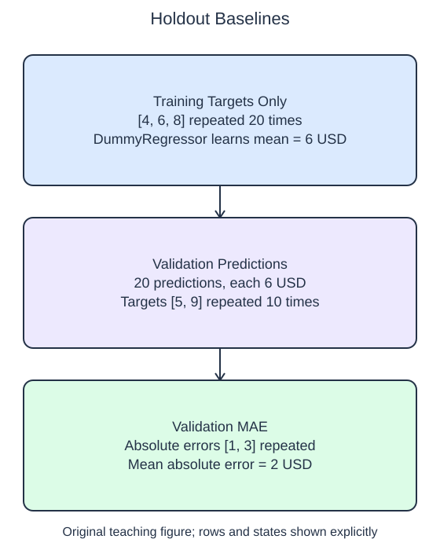

# Measure a simple baseline

A baseline asks what a model can achieve without using the feature relationships. `DummyRegressor(strategy="mean")` learns the mean training target and predicts that same number for every query row. Its purpose is to provide a reference, not to explain why individual packages cost different amounts.

## Dataset

**Row grain:** one synthetic handling observation. **Files:** `training.csv` (60 rows), `validation.csv` (20 rows).

| Column | Meaning | Type / unit | Role / availability |
| --- | --- | --- | --- |
| `feature_0` | Generated feature 0 | float; unitless | Input; ignored by dummy |
| `target` | Handling cost | float; USD | Later regression target |

Original synthetic HomeHurray Inc. teaching data; no actual customer records or measured business-performance claims. These files have complete values; no missing-value sentinel is present. Training, validation, and query filenames describe supplied membership, not predictor columns.

## Worked explanation

Fit the dummy on the training arrays, then predict validation inputs. `mean_absolute_error(y_valid, predictions)` averages the absolute differences between the observed and predicted values. The result has the target's units, so an error of 2 here means 2 USD per validation row on average. Smaller is better for this metric, but this lesson sets no required quality threshold.

The starter fits on validation targets. That gives the reference access to the outcomes it is about to be evaluated against. Change only the fit arguments and inspect the resulting constant prediction and error. The reported value must describe a training-learned baseline applied to held-out observations.

For a classification target, the related baseline is `DummyClassifier(strategy="most_frequent")`. It learns the most frequent training class and predicts that label for every row. The exercise evaluates it with `accuracy_score(y_valid, predictions)`, the fraction of correctly predicted labels. Larger accuracy is better, unlike an error metric.

Accuracy can be high when the majority class dominates, even though the dummy never recognizes the minority class. Keep the class shares beside any interpretation. A model should be compared with a suitable baseline under the same split and metric, rather than against an arbitrary impressive-looking number.

These synthetic fixtures have repeated target values to make the reference arithmetic transparent. The resulting metrics demonstrate the evaluation procedure; they are not evidence that a retail prediction system is useful.

The supplied setup reads `training.csv` (60 rows), `validation.csv` (20 rows). Open the read-only data tabs to inspect the records; edit only `main.py`. `pd.read_csv` reads the actual CSV file into a DataFrame; selecting named columns and calling `to_numpy()` gives the arrays used by the estimator. Empty numeric cells become NaN. 

## Worked calculation

For $n$ rows, targets $y_i$, and predictions $\hat y_i$, with $i$ indexing the rows, mean absolute error is

$$
\mathrm{MAE}=\frac{1}{n}\sum_i|y_i-\hat y_i|.
$$

A training mean of 6 USD predicts 6 for targets 5 and 9, giving $(1+3)/2=2$ USD. Separately, accuracy is $a=c/n$, where $c$ counts correct labels. Predicting 0 for `[0, 1, 0, 0]` gives $a=3/4=0.75$.

## Small edit

Change the fit arguments from the validation arrays to `X_train, y_train`.

Edit `main.py`, press Run to inspect the supplied probe, then Submit to check the behavior.

## Your Tasks

1. Return a `DummyRegressor(strategy="mean")` fitted only on training arguments and its validation `mean_absolute_error`, computed from predictions for `X_valid`.
