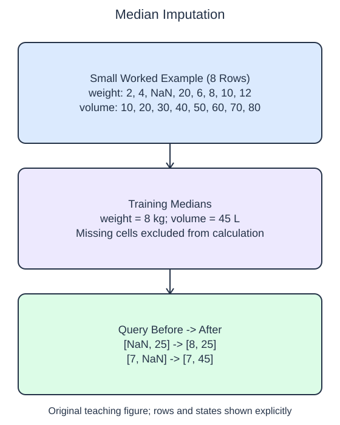

# Fill missing numerical values

A missing measurement is not automatically zero. `SimpleImputer` learns replacement values from training columns, then inserts those values wherever a later matrix contains the chosen missing marker. For these numeric arrays the marker is `np.nan`.

## Dataset

**Row grain:** one synthetic package measurement. **Files:** `training.csv` (32 rows), `queries.csv` (2 rows).

| Column | Meaning | Type / unit | Role / availability |
| --- | --- | --- | --- |
| `weight_kg` | Package weight | float; kg | Input recorded before handling |
| `volume_l` | Packaged volume | float; liters | Input recorded before handling/listing |

Original synthetic HomeHurray Inc. teaching data; no actual customer records or measured business-performance claims. An empty numeric CSV cell means not recorded, not zero; pandas reads it as NaN. The figure uses the explicitly labeled eight-row illustration; the files contain the larger runnable dataset. Training, validation, and query filenames describe supplied membership, not predictor columns.

## Worked explanation

With `strategy="median"`, the imputer sorts the observed values in each training column and uses their middle value, or the mean of the two middle values for an even count. Missing values do not participate in that calculation. The learned replacements appear in `statistics_`, one per original feature when the requested shape policy retains all columns.

The helper fits on `train` and transforms `query`. A query may contain an extreme observed value or many missing cells; neither should change the fitted replacements. Observed query cells remain unchanged. Imputation fills unavailable measurements according to a declared rule; it does not recover their true unknown values.

The starter uses the mean strategy. Both mean and median are valid options, but the task asks for a median because an unusually large training value affects it differently. Change the strategy and inspect the first learned statistic. The separate eight-row illustration has a weight median of 8 kg. The larger training file has its own median, printed by the probe.

`keep_empty_features=True` makes the feature-width policy explicit. If a training column is entirely missing, there is no observed median. Under this setting the numeric median imputer retains that column and fills missing cells with zero. This is a fallback convention, not evidence that the real measurements were zero. Without a deliberate policy, an all-empty feature can disappear and surprise downstream code.

The next lesson records which cells were originally missing, so replacement does not have to erase that information from the representation.

The supplied setup reads `training.csv` (32 rows), `queries.csv` (2 rows). Open the read-only data tabs to inspect the records; edit only `main.py`. `pd.read_csv` reads the actual CSV file into a DataFrame; selecting named columns and calling `to_numpy()` gives the arrays used by the estimator. Empty numeric cells become NaN. 

## Worked calculation

The observed weights in the separate eight-row illustration sort to $2,4,6,8,10,12,20$ kg. For seven observed values, the median is the fourth value: $8$ kg. A missing query weight is therefore filled with 8 kg. The volume median is $(40+50)/2=45$ liters.

## Small edit

Change the strategy from `"mean"` to `"median"`.

Edit `main.py`, press Run to inspect the supplied probe, then Submit to check the behavior.

## Your Tasks

1. Fit `SimpleImputer(strategy="median", keep_empty_features=True)` on `train` only and return `(imputer, imputer.transform(query))`, retaining the feature columns even if one has no observed training values.
