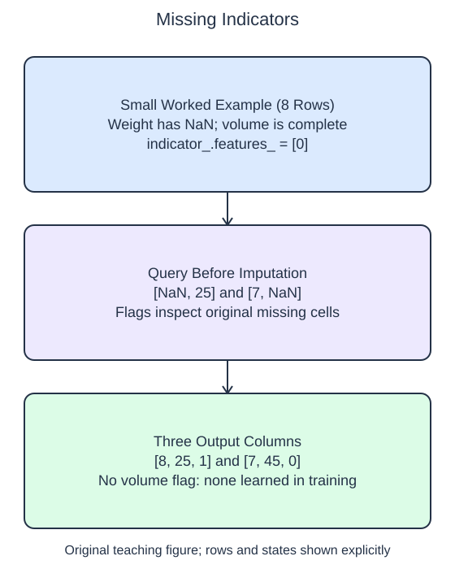

# Keep missingness information

Replacing a missing value can make it indistinguishable from a genuinely observed value equal to the replacement. An appended indicator preserves whether the original cell was missing. It is a separate feature, not a confidence score for the imputed number.

## Dataset

**Row grain:** one synthetic package measurement. **Files:** `training.csv` (32 rows), `queries.csv` (2 rows).

| Column | Meaning | Type / unit | Role / availability |
| --- | --- | --- | --- |
| `weight_kg` | Package weight | float; kg | Input recorded before handling |
| `volume_l` | Packaged volume | float; liters | Input recorded before handling/listing |

Original synthetic HomeHurray Inc. teaching data; no actual customer records or measured business-performance claims. An empty numeric CSV cell means not recorded, not zero; pandas reads it as NaN. The figure uses the explicitly labeled eight-row illustration; the files contain the larger runnable dataset. Training, validation, and query filenames describe supplied membership, not predictor columns.

## Worked explanation

Set `add_indicator=True` on `SimpleImputer`. The transformed matrix begins with the imputed original columns and then appends indicator columns. A flag is 1 when the corresponding original query cell was missing and 0 when it was observed. The flags describe the input before replacement; inspecting the already filled matrix would lose that information.

The imputer decides which indicator columns to create during fitting. `imputer.indicator_.features_` contains the original feature positions that had at least one missing training value. In this demo only weight, position 0, qualifies. Two original columns therefore expand to three output columns, not four.

The query contains a missing volume even though training volume was complete. That volume is still imputed, but it does not create a new indicator column. Expanding the representation at prediction time would change its schema after fitting. Read this caveat carefully: `add_indicator=True` does not mean that every possible feature always receives a flag.

Run the starter, enable indicators, and compare the output shape. The first query's appended weight flag should be 1; the second query's weight flag should be 0 even though its volume is missing. Use the printed source positions to interpret flags rather than guessing their meaning from the last column alone.

Missingness can be associated with a target, but this example makes no claim that these flags improve a model. It teaches a representation that later evaluation can compare fairly.

The supplied setup reads `training.csv` (32 rows), `queries.csv` (2 rows). Open the read-only data tabs to inspect the records; edit only `main.py`. `pd.read_csv` reads the actual CSV file into a DataFrame; selecting named columns and calling `to_numpy()` gives the arrays used by the estimator. Empty numeric cells become NaN. 

## Small edit

Change `add_indicator=False` to `add_indicator=True`.

Edit `main.py`, press Run to inspect the supplied probe, then Submit to check the behavior.

## Your Tasks

1. Return a training-fitted median `SimpleImputer` and its query transform with `add_indicator=True` and `keep_empty_features=True`, appending missingness flags after the imputed feature columns.
