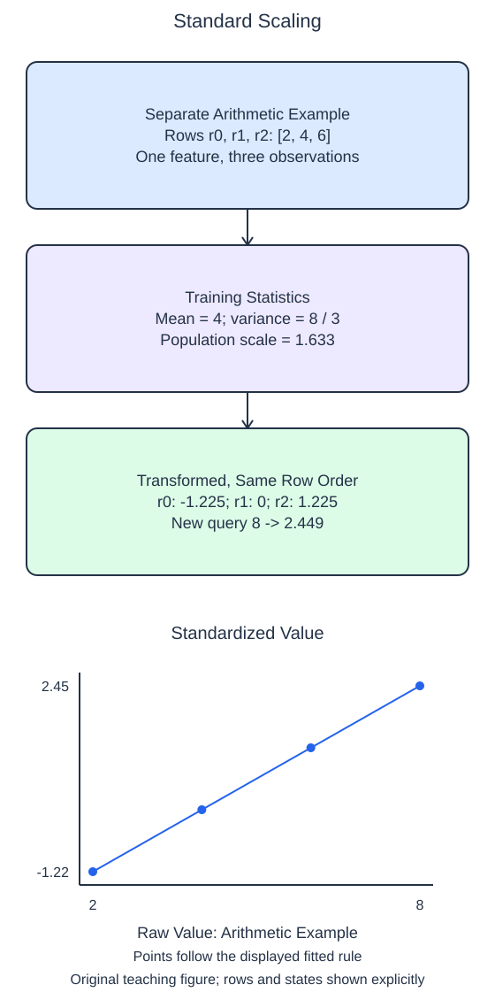

# Standardize numerical features

Standard scaling subtracts a training mean and divides by a training standard deviation, separately for each column. It preserves row order and feature count while changing the numerical coordinate system. A large raw-unit range therefore does not automatically give a feature a large standardized range.

## Dataset

**Row grain:** one independent generated observation. **Files:** `training.csv` (80 rows), `queries.csv` (2 rows).

| Column | Meaning | Type / unit | Role / availability |
| --- | --- | --- | --- |
| `feature_0` | Generated feature 0 | float; unitless | Input; original column order |
| `feature_1` | Generated feature 1 | float; unitless | Input; original column order |

Synthetic make_regression export: 80 samples, 2 features (all informative), noise=0, random_state=17. These are generated observations, not measured HomeHurray Inc. records. These files have complete values; no missing-value sentinel is present. Training, validation, and query filenames describe supplied membership, not predictor columns.

## Worked explanation

`StandardScaler()` enables both steps by default. After fitting, `mean_` records the training mean, `var_` records the population variance, and `scale_` records the divisor used by transformation. The population convention divides squared deviations by the training count, matching NumPy's `std(..., ddof=0)`, rather than the sample estimate with `ddof=1`.

For a constant training column, the variance is zero. Dividing by zero would be undefined, so the scaler uses a scale of 1 for that column. Its training values become zero after centering. A later different value in that column becomes its offset from the training constant; the scaler does not refit merely because the query varies.

The starter has `with_std=False`, so it centers values but does not divide by their spread. Enable standard-deviation scaling and compare the printed state and query values. The generated fixture is supplied for a slightly wider example; the separate three-value calculation below makes the exact arithmetic easier to follow.

A transformed training column usually has mean zero and population standard deviation one unless it is constant. A validation or query column need not have those statistics: it uses the training values, not its own. Standard scaling also does not force observations into a bounded interval and does not remove outliers. The next two scaling lessons show different transformations rather than interchangeable names for this one.

The supplied setup reads `training.csv` (80 rows), `queries.csv` (2 rows). Open the read-only data tabs to inspect the records; edit only `main.py`. `pd.read_csv` reads the actual CSV file into a DataFrame; selecting named columns and calling `to_numpy()` gives the arrays used by the estimator. Empty numeric cells become NaN. 

## Worked calculation

For one feature with $n$ training values $x_i$, where $i$ indexes the rows, let $\mu$ be the training mean and $s$ the population standard deviation:

$$
\mu=\frac{1}{n}\sum_i x_i,\qquad s=\sqrt{\frac{1}{n}\sum_i(x_i-\mu)^2}.
$$

For the separate values 2, 4, 6, $\mu=4$ and $s=\sqrt{8/3}\approx1.633$. A query $x=8$ gives the scaled value $z$:

$$
z=\frac{x-\mu}{s}=\frac{8-4}{1.633}\approx2.449.
$$

The subtraction and divisor use the same original unit, so $z$ is dimensionless. A constant column instead uses divisor 1.

## Small edit

Remove `with_std=False` (or change it to `True`) so both centering and scaling occur.

Edit `main.py`, press Run to inspect the supplied probe, then Submit to check the behavior.

## Your Tasks

1. Fit a default `StandardScaler` on `train` only, with both centering and standard-deviation scaling enabled, and return the scaler and its transformed query matrix.
