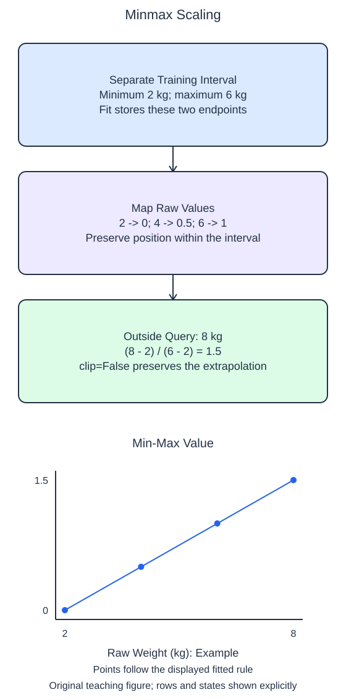

# Rescale to a training range

Min-max scaling uses the smallest and largest training values as reference endpoints. With `feature_range=(0, 1)`, the training minimum maps to 0 and the training maximum maps to 1. Values between them keep their relative positions along the interval.

## Dataset

**Row grain:** one independent generated observation. **Files:** `training.csv` (80 rows), `queries.csv` (2 rows).

| Column | Meaning | Type / unit | Role / availability |
| --- | --- | --- | --- |
| `feature_0` | Generated feature 0 | float; unitless | Input; original column order |
| `feature_1` | Generated feature 1 | float; unitless | Input; original column order |

Synthetic make_regression export: 80 samples, 2 features (all informative), noise=0, random_state=17. These are generated observations, not measured HomeHurray Inc. records. These files have complete values; no missing-value sentinel is present. Training, validation, and query filenames describe supplied membership, not predictor columns.

## Worked explanation

Fit a `MinMaxScaler` on training rows, then transform the query with that fitted object. `data_min_` and `data_max_` record the raw training endpoints. As with standard scaling, each feature column gets its own fitted state, and the transformed matrix retains its row and column counts.

The training interval does not guarantee that future inputs will remain inside it. A query above the training maximum maps above 1; a query below the minimum maps below 0. `clip=False` retains this information. `clip=True` instead truncates transformed query values to the chosen range, which can make several distinct out-of-range measurements become the same number.

The starter enables clipping. Its output stays in the interval, but that is not the behavior this task requests. Disable clipping, Run again, and inspect the extreme query rows. Values beyond 0–1 are expected results of applying an unchanged training scale, not an error to fix by fitting on the query.

Min-max scaling is sensitive to extreme training endpoints: one very large training observation can compress the remaining values into a narrow part of the output range. It does not remove that observation or make the distribution uniform. Compare the stated goal of a transformation rather than treating all scalers as interchangeable.

For a constant feature, the library handles the zero training range without division by zero. The hand calculation below uses distinct endpoints so the basic formula is visible without that special case.

The supplied setup reads `training.csv` (80 rows), `queries.csv` (2 rows). Open the read-only data tabs to inspect the records; edit only `main.py`. `pd.read_csv` reads the actual CSV file into a DataFrame; selecting named columns and calling `to_numpy()` gives the arrays used by the estimator. Empty numeric cells become NaN. 

## Worked calculation

For a nonconstant feature, let $x$ be a raw query value, and let $a$ and $b$ be the training minimum and maximum in the same units. The dimensionless scaled value $z$ is

$$
z=\frac{x-a}{b-a}.
$$

A separate interval of 2–6 kg maps a query of 8 kg to

$$
z=\frac{8-2}{6-2}=1.5.
$$

The result is dimensionless and exceeds 1 because the query exceeds the training maximum.

## Small edit

Change `clip=True` to `clip=False`.

Edit `main.py`, press Run to inspect the supplied probe, then Submit to check the behavior.

## Your Tasks

1. Fit `MinMaxScaler(feature_range=(0, 1), clip=False)` on `train` only and return its fitted object and transformed query, allowing new values outside the training range to map outside 0–1.
