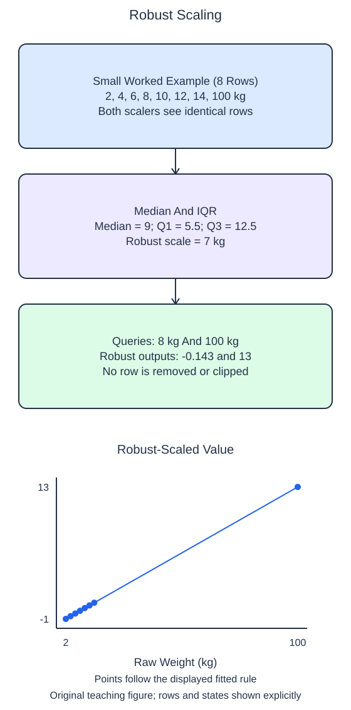

# Scale with robust statistics

A large training observation can strongly affect a mean and standard deviation. `RobustScaler` instead centers each feature on its training median and usually divides by its interquartile range, the distance between the 75th and 25th percentiles. These summaries focus on the middle of the training distribution.

## Dataset

**Row grain:** one synthetic package measurement. **Files:** `training.csv` (32 rows), `queries.csv` (2 rows).

| Column | Meaning | Type / unit | Role / availability |
| --- | --- | --- | --- |
| `weight_kg` | Package weight | float; kg | Input recorded before handling |

Original synthetic HomeHurray Inc. teaching data; no actual customer records or measured business-performance claims. These files have complete values; no missing-value sentinel is present. The figure uses the explicitly labeled eight-row illustration; the files contain the larger runnable dataset. Training, validation, and query filenames describe supplied membership, not predictor columns.

## Worked explanation

Set `quantile_range=(25, 75)` explicitly so the intended percentiles are visible. After fitting, `center_` contains the medians and `scale_` contains the divisors. The helper then transforms the query without relearning either value. The supplied comparison uses a separately fitted `StandardScaler` on the same training rows, so you can inspect two coordinate systems for identical observations.

Run the starter, which currently uses standard scaling for both outputs. Change the helper's estimator and compare again. The ordinary query and the extreme query remain present in both results. Robust scaling does not remove, cap, or repair an outlier; a very large raw observation can still have a very large robust-scaled value.

Percentiles require a convention between observed values. NumPy's default linear interpolation, used in the worked check, can place a quartile between two values. Do not assume every quartile must be one of the table's existing entries. The example below uses the exact convention behind the displayed interquartile range.

A median/IQR representation is not automatically better for every estimator or dataset. Which transformation helps predictive performance is an evaluation question, not something these two printed columns decide. This lesson only compares their fitted arithmetic while keeping the training boundary and original rows fixed.

For a zero interquartile range, the library avoids dividing by zero. As with other degenerate columns, interpret that fallback separately from evidence about feature usefulness.

The supplied setup reads `training.csv` (32 rows), `queries.csv` (2 rows). Open the read-only data tabs to inspect the records; edit only `main.py`. `pd.read_csv` reads the actual CSV file into a DataFrame; selecting named columns and calling `to_numpy()` gives the arrays used by the estimator. Empty numeric cells become NaN. 

## Worked calculation

Let $x$ be a raw query measurement, $m$ the training median, and $Q_1,Q_3$ the training 25th and 75th percentiles, all in the same unit. The scaled value $z$ is dimensionless:

$$
z=\frac{x-m}{Q_3-Q_1}.
$$

For the separate eight-row illustrated values, $m=9$, $Q_1=5.5$, and $Q_3=12.5$ kg, so the IQR is 7 kg. The 8 kg query has $z\approx-0.143$. The 100 kg query gives

$$
z=\frac{100-9}{7}=13.
$$

The extreme value remains extreme.

## Small edit

Replace `StandardScaler()` inside the helper with `RobustScaler(quantile_range=(25, 75))`.

Edit `main.py`, press Run to inspect the supplied probe, then Submit to check the behavior.

## Your Tasks

1. Fit `RobustScaler(quantile_range=(25, 75))` only on `train` and return the fitted scaler with its query transform, retaining every query row.
