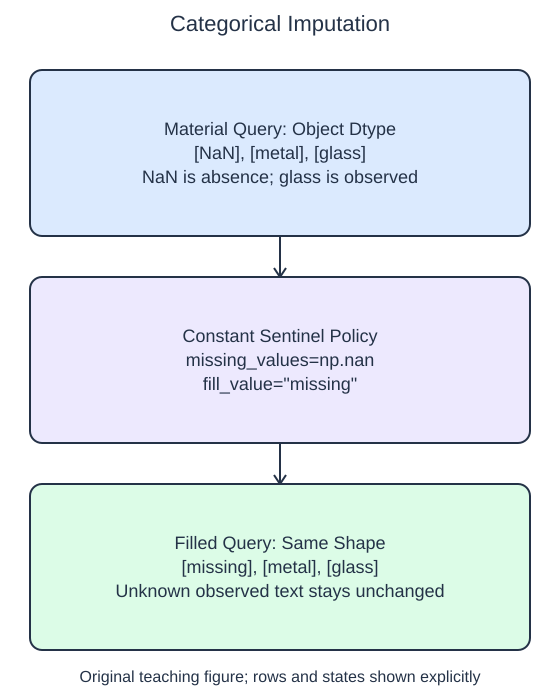

# Fill missing categories

A missing category and an unfamiliar category are different. A missing material means no value was recorded. A query containing `"glass"` is observed information even if glass never appeared in the training examples. Imputation should not erase that distinction.

## Dataset

**Row grain:** one synthetic catalog item. **Files:** `categories.json` (32 rows), `queries.json` (3 rows).

| Column | Meaning | Type / unit | Role / availability |
| --- | --- | --- | --- |
| `category` | Material: wood/metal/fabric | object string; nominal | Input metadata known before listing |

Original synthetic HomeHurray Inc. teaching data; no actual customer records or measured business-performance claims. JSON null means metadata not recorded; the reader converts it to np.nan, distinct from an observed unfamiliar category. Queries include additional observed strings; unknown values are not missing. The imputation sentinel `missing` is reserved, not a genuine category. Training, validation, and query filenames describe supplied membership, not predictor columns.

## Worked explanation

Use `SimpleImputer` with `strategy="constant"` and `fill_value="missing"` to make absence explicit. The sentinel string is a declared category value meaning unavailable metadata; it is not a claim about the item's actual material. Reserve that spelling so it cannot be confused with an ordinary category already used by the catalog.

The arrays specify `dtype=object` because they mix Python strings with the floating missing marker `np.nan`. Without an appropriate dtype, array construction can convert a missing marker into the ordinary text `"nan"`. A text string that happens to spell nan is not the same marker the imputer is configured to replace. This lesson deliberately uses one consistent marker rather than mixing empty strings, `None`, and NaN.

The starter uses the most-frequent category, which fills missing cells with the common training material. That is another valid policy, but it does not preserve absence as a distinct category. Switch to the requested constant policy and inspect the output: the missing query becomes `"missing"`, while `"metal"` and `"glass"` remain unchanged.

The helper still fits on training and transforms the query, keeping the same estimator workflow as numeric imputation. `keep_empty_features=True` declares that even an entirely absent training feature remains in the output. In this constant-policy lesson it receives the same sentinel. Encoding these resulting strings as numeric features comes next.

The supplied setup reads `categories.json` (32 rows), `queries.json` (3 rows). Open the read-only data tabs to inspect the records; edit only `main.py`. `pd.read_json(..., orient="records")` reads the actual array of record objects into a DataFrame. The reader explicitly keeps category values as object data and disables date inference. It maps JSON null to np.nan, then selects the category column before `to_numpy(dtype=object)` at the transformer boundary. Inspect `training.shape`, `training.columns`, and `training.dtypes` if the schema is unclear. 

## Small edit

Replace the most-frequent strategy with the constant strategy and add `fill_value="missing"`.

Edit `main.py`, press Run to inspect the supplied probe, then Submit to check the behavior.

## Your Tasks

1. Fit a `SimpleImputer` using `missing_values=np.nan`, `strategy="constant"`, `fill_value="missing"`, and `keep_empty_features=True`; return it and its query transform without changing observed strings.
