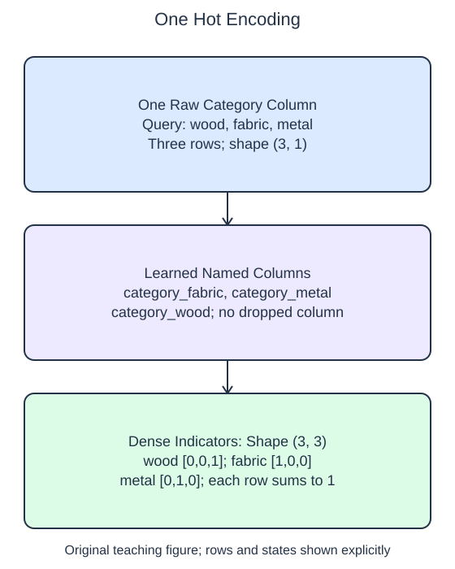

# Encode nominal categories

A nominal category has no built-in numerical order. Assigning wood 1, metal 2, and fabric 3 would introduce distances that those material names do not imply. One-hot encoding instead creates a separate indicator column for each learned category.

## Dataset

**Row grain:** one synthetic catalog item. **Files:** `categories.json` (32 rows), `queries.json` (3 rows).

| Column | Meaning | Type / unit | Role / availability |
| --- | --- | --- | --- |
| `category` | Material: wood/metal/fabric | object string; nominal | Input metadata known before listing |

Original synthetic HomeHurray Inc. teaching data; no actual customer records or measured business-performance claims. JSON null means metadata not recorded; the reader converts it to np.nan, distinct from an observed unfamiliar category. All supplied queries use known categories; this lesson keeps the unknown-category policy as error. Training, validation, and query filenames describe supplied membership, not predictor columns.

## Worked explanation

`OneHotEncoder.fit(train)` learns the vocabulary for each input feature and stores it in `categories_`. For this single string column the categories are sorted, so inspect the learned order rather than assuming that first appearance determines the columns. Each query row becomes a numeric row containing 1 in its category's column and 0 elsewhere.

Set `sparse_output=False` to obtain a small dense NumPy array that can be printed directly. The encoder's usual sparse representation saves space when most entries are zero, but this tiny table is easier to inspect densely. That readability choice is suitable for the small vocabulary here, not a recommendation to densify very large tables.

`get_feature_names_out(["category"])` returns names in the same order as the encoded columns. The supplied input name combines with each category, making it possible to trace a numeric position back to its meaning. The list has one input name because the raw matrix has one input column; the output can have several columns.

The starter uses `drop="first"`, so it deliberately omits one category column. That is a supported option, but the present task asks for the full representation. Change to `drop=None` and verify that each known query row sums to one. `handle_unknown="error"` makes the policy for novel categories explicit: this lesson accepts only known ones. The following lesson changes that policy without changing the fitted vocabulary.

The supplied setup reads `categories.json` (32 rows), `queries.json` (3 rows). Open the read-only data tabs to inspect the records; edit only `main.py`. `pd.read_json(..., orient="records")` reads the actual array of record objects into a DataFrame. The reader explicitly keeps category values as object data and disables date inference. It maps JSON null to np.nan, then selects the category column before `to_numpy(dtype=object)` at the transformer boundary. Inspect `training.shape`, `training.columns`, and `training.dtypes` if the schema is unclear. 

## Small edit

Change `drop="first"` to `drop=None` so every learned category gets an output column.

Edit `main.py`, press Run to inspect the supplied probe, then Submit to check the behavior.

## Your Tasks

1. Fit a dense `OneHotEncoder` on training categories with `handle_unknown="error"` and `drop=None`; return `(encoder, encoded_query, names)` using `get_feature_names_out(["category"])`.
