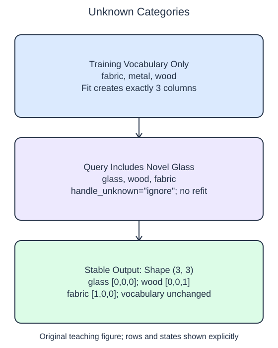

# Handle unseen categories

A new product can have a category that was absent during fitting. The previous encoder rejected that situation explicitly. `handle_unknown="ignore"` changes transformation behavior: a novel category produces zeros across the fitted indicator columns for that input feature.

## Dataset

**Row grain:** one synthetic catalog item. **Files:** `categories.json` (32 rows), `queries.json` (3 rows).

| Column | Meaning | Type / unit | Role / availability |
| --- | --- | --- | --- |
| `category` | Material: wood/metal/fabric | object string; nominal | Input metadata known before listing |

Original synthetic HomeHurray Inc. teaching data; no actual customer records or measured business-performance claims. JSON null means metadata not recorded; the reader converts it to np.nan, distinct from an observed unfamiliar category. Queries include additional observed strings; unknown values are not missing. Training, validation, and query filenames describe supplied membership, not predictor columns.

## Worked explanation

The word ignore does not mean removing the row. The output still contains one row per query and the same fitted column width. Known categories continue to activate their original columns. `categories_` must remain the training vocabulary; otherwise a downstream model trained on the old columns would receive a different representation.

The starter avoids an error by fitting on training and query categories together. That makes the new material a learned category and grows the output width. Although the code runs, it does not respect the training boundary. Fit on `train` only and let the configured unknown policy handle the query. Run again and compare both the vocabulary and the novel row.

Keep `drop=None` for this example. With all learned categories represented, a known single-category row has one 1 and a novel row has no 1. If a known reference category were deliberately dropped, its all-zero representation could be confused with the novel-category representation. This is one reason an all-zero row needs interpretation rather than a blanket label.

An unknown category is not automatically missing metadata. The query's glass value was observed; it simply lies outside this fitted vocabulary. Constant imputation and unknown-category encoding therefore solve separate problems. Multiple different novel categories collapse to the same zero representation here, so the model cannot distinguish them using this feature alone.

This policy keeps the schema stable, but it does not guarantee useful predictions for a changing catalog. That limitation belongs alongside any later evaluation report.

The supplied setup reads `categories.json` (32 rows), `queries.json` (3 rows). Open the read-only data tabs to inspect the records; edit only `main.py`. `pd.read_json(..., orient="records")` reads the actual array of record objects into a DataFrame. The reader explicitly keeps category values as object data and disables date inference. It maps JSON null to np.nan, then selects the category column before `to_numpy(dtype=object)` at the transformer boundary. Inspect `training.shape`, `training.columns`, and `training.dtypes` if the schema is unclear. 

## Small edit

Replace the combined `np.vstack([train, query])` fit input with `train`.

Edit `main.py`, press Run to inspect the supplied probe, then Submit to check the behavior.

## Your Tasks

1. Fit a dense `OneHotEncoder(handle_unknown="ignore", drop=None)` on `train` only and return the encoder with its query transform, giving novel categories all-zero rows without extending the vocabulary.
