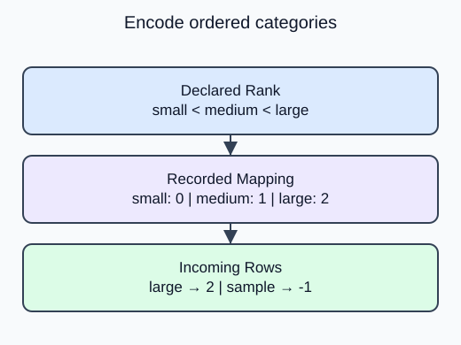

A product size has an order that its spelling does not reveal. Encode small, medium and large in that order before using the values as features.

`OrdinalEncoder` expects a two-dimensional table, even for one feature. Its `categories` argument contains one ordered list per input column. With an explicit list, the model does not have to guess the meaning of alphabetical order. `fit` records the mapping; `transform` reuses it on new rows.

Here, small maps to 0, medium to 1 and large to 2. These codes preserve rank, but they also impose equal numeric gaps. That may be an unsuitable assumption for a linear model. A material such as glass, wood or steel has no natural rank; use one-hot encoding for those nominal values instead.

Set `handle_unknown="use_encoded_value"` with `unknown_value=-1` to reserve a separate code for a label absent from the declared vocabulary. The sentinel does not mean that an unknown size is physically smaller than small. It is a policy the downstream model must handle deliberately. Missing values are a separate issue and should follow the imputation policy taught earlier.

After the edit, the large query receives 2 rather than 0. The unknown label remains -1; changing the rank should not change the unknown policy.

## Your Tasks

1. In `encode_sizes`, replace the reversed category list with the supplied `levels` order. Return the transformed incoming rows; keep the unknown code at -1.

Edit `main.py`, press **Run** to inspect the supplied output, then **Submit** to check this task.
