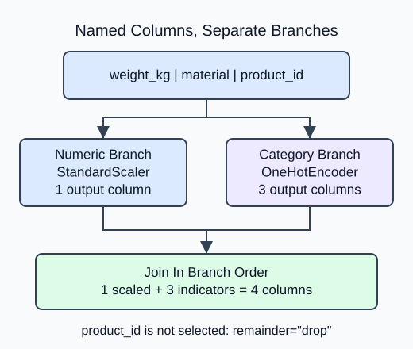
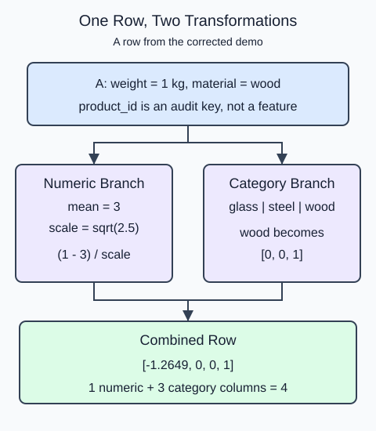

A mixed product table needs different operations for measurements and material labels. Keep those routes explicit rather than converting the whole table to numbers at once.

A `ColumnTransformer` takes named branches. Each branch is a tuple of a name, a transformer and a list of column names. It selects those columns, fits that transformer on the selected training values, and joins the branch outputs horizontally. Branch order determines output order; it is not the original table order.

The numeric branch standardizes one measurement. The categorical branch produces one column per material with `OneHotEncoder(sparse_output=False, handle_unknown="ignore")`. Dense output keeps this small example readable. An unseen material gets zeros in the material block, not a newly fitted category.

`remainder="drop"` excludes everything not explicitly selected. In particular, a product ID is an audit key, not a measurement. `get_feature_names_out()` exposes the branch and original feature in each output name. Fit once on training rows, then call `transform` on queries. These tables are clean so routing is the only new problem; missing values return in the next lesson.

For this example, the output width is the sum of branch widths:

$$
p_{out}=p_{num}+p_{cat}=1+3=4.
$$

Here $p$ counts columns. One numeric measurement stays one column; three learned categories contribute three more.

The first output column now has training mean zero. Its name starts with numeric; category columns follow it. The ID disappears because no branch selected it.

### Follow one row

In the corrected demo, the training weights are 1, 2, 4, and 5 kg. Their mean is 3 and their population variance is 2.5, so the first weight becomes $(1-3)/\sqrt{2.5} \approx -1.2649$. The encoder orders the observed materials as glass, steel, wood; wood therefore becomes `[0, 0, 1]`. The transformer joins the numeric result to that category vector. `product_id` stays outside both branches.

The two branches learn different things, but their transformed rows stay aligned. Four output columns do not mean four original measurements.

## Your Tasks

1. Replace the numeric branch passthrough with `StandardScaler()` in `route_columns`. Keep named routing and the fitted router return value.

Edit `main.py`, press **Run** to inspect the supplied output, then **Submit** to check this task.
