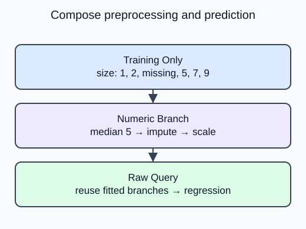

A new product row may be missing a measurement, but it still needs a prediction. The imputer, scaler, and category encoder must apply exactly what they learned during training. A pipeline keeps those steps together so you can pass the raw row to one fitted object.

`Pipeline` runs named steps in order. During `fit`, each intermediate step fits and transforms its input; the final regressor fits the resulting matrix. During `predict`, the intermediate steps only transform, so incoming rows cannot change the training medians, means or category vocabulary.

The supplied `preprocessor()` uses two branch pipelines inside a `ColumnTransformer`. The numeric branch performs median imputation before scaling. The categorical branch fills missing labels with the most frequent training label before one-hot encoding. Each branch receives only its named columns. The outer pipeline then attaches `LinearRegression(n_jobs=1)` as `model`.

The double nesting has a practical purpose: operations that happen in sequence stay together, while operations on different columns run in separate branches. Call `fit(training, target)` on the outer pipeline, not on individual transformers with the full dataset. This lesson asks for that one boundary. It does not compare models or establish pricing quality.

A missing query remains valid because the fitted imputer supplies a median. Predicting a very large size must not change the scaler mean.

## Your Tasks

1. Fit the outer pipeline on the unmodified `training` table instead of filling its missing size with zero first. Let the supplied numeric branch learn its training median.

Edit `main.py`, press **Run** to inspect the supplied output, then **Submit** to check this task.
