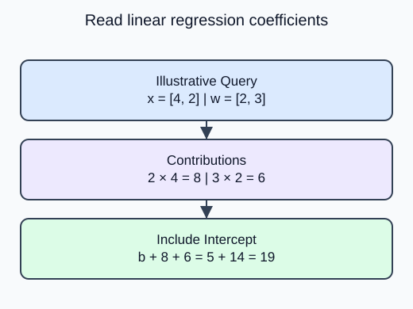

Read a fitted price equation without confusing a coefficient with a business intervention.

`LinearRegression.coef_` follows the training feature-column order. `intercept_` is the prediction when every input is zero. For unscaled weight in kilograms and volume in liters, the coefficients have units of dollars per kilogram and dollars per liter. A coefficient describes the fitted change when that feature increases by one unit while the other input values stay fixed.

## Dataset

`regression-measurements.csv` contains **80 fixed synthetic rows**. The supplied code reads the real CSV with `pd.read_csv`, then selects a feature DataFrame and a separate target Series. Keep those labeled pandas objects through splitting; estimators accept them directly. Each row is one independent synthetic measurement observation. These are dimensionless teaching measurements, not observed HomeHurray sales, prices or customer outcomes. No values are missing.

| Columns | Type / unit | Availability and role |
|---|---|---|
| feature_1, feature_2 | float, dimensionless | measured before label assignment; predictors |
| target_value | float, arbitrary target units | assigned after features; target only |

The CSV row position preserves the original fixture order. It is not a predictor or entity ID. The supplied split uses that same row order and seed as the worked example. The target must never appear in X. `float_precision="round_trip"` preserves saved numeric precision; file loading is supplied setup, not another task.

## Worked explanation

That conditional statement is about the equation. It does not prove that changing packaging causes a price change. Correlated measurements can make individual coefficients unstable even when predictions are useful. The intercept may describe an impossible zero-size product; it is still needed to position the fitted plane.

The supplied estimator is already fitted on the training portion of the synthetic CSV. Your helper reconstructs predictions from its learned attributes on new rows. Matrix multiplication combines one query row with the coefficient vector and returns one number per row. If you later scale inputs, the coefficients belong to those scaled units instead of raw kilograms or liters.

For prediction $\hat y$, intercept $b$, feature $x_j$ and coefficient $w_j$:

$$
\hat y=b+\sum_j w_jx_j.
$$

An illustrative two-feature equation with $b=5$, $w=(2,3)$ and $x=(4,2)$ gives

$$
\hat y=5+2(4)+3(2)=19.
$$

These illustrative values explain the arithmetic; the editor prints the separately fitted generator model.

The reconstructed vector now agrees with `predict`, including its offset. Agreement checks the equation, not held-out model quality.

## Your Tasks

1. Add `model.intercept_` to the coefficient contributions returned by `reconstruct`.

Edit `main.py`, press **Run** to inspect the supplied output, then **Submit** to check this task.
