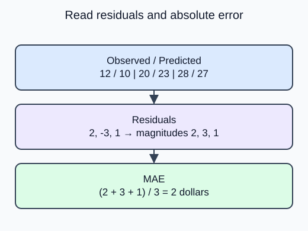

Summarize how far validation price predictions miss their targets without allowing overestimates and underestimates to cancel.

A residual is the observed target minus its prediction. A positive residual means the model underpredicted. A negative one means it overpredicted. Keep the two arrays in the same row order; subtraction cannot detect a shuffled target column.

`mean_absolute_error(y_true, y_pred)` takes the magnitude of every residual before averaging. MAE therefore has the target unit, such as dollars, and every extra dollar of error contributes equally. The mean signed residual answers a different question about average bias. It can be zero even when every prediction is wrong.

The editor supplies synthetic validation predictions, so computing a metric does not fit any estimator. In a modeling workflow these predictions must come from a model trained without those validation targets. Use validation for comparison; keep final test errors out of this selection loop.

Let $r_i=y_i-\hat y_i$ be row $i$'s residual and $n$ the number of rows.

$$
\mathrm{MAE}=\frac{1}{n}\sum_i |r_i|.
$$

For residuals $2,-3,1$ dollars:

$$
\mathrm{MAE}=\frac{2+3+1}{3}=2\text{ dollars}.
$$

The signed average is zero, which hides all three misses.

The first vector still contains a negative residual. The scalar becomes 2 rather than the misleading signed average of zero.

## Your Tasks

1. Replace the signed residual average with `mean_absolute_error(actual, predicted)`. Keep the residual vector as the first return item.

Edit `main.py`, press **Run** to inspect the supplied output, then **Submit** to check this task.
