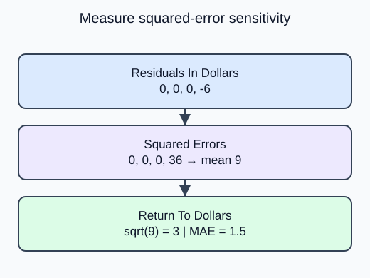

One large pricing error can matter more than several small errors. Compare a squared-error summary with the absolute-error summary you already know.

`root_mean_squared_error(actual, predicted)` squares residuals, averages those squares and takes the square root. The square root returns the metric to the target unit. Mean squared error alone is in squared dollars, so it is not interchangeable with RMSE.

Squaring makes a large miss contribute disproportionately. RMSE and MAE are both nonnegative and both are zero for perfect predictions, but they need not rank two models the same way. Choose a comparison metric before inspecting final test results rather than switching to whichever flatters the model.

The supplied probe prints both metrics on identical validation rows. You change only the RMSE calculation. No training or refitting belongs inside this helper.

For residual $r_i$ and row count $n$:

$$
\mathrm{RMSE}=\sqrt{\frac{1}{n}\sum_i r_i^2}.
$$

For dollar residuals $0,0,0,-6$:

$$
\mathrm{RMSE}=\sqrt{36/4}=3\text{ dollars}.
$$

On those same rows, MAE is $6/4=1.5$ dollars.

The corrected RMSE is 3 dollars, not 9 squared dollars. The MAE stays 1.5 because both metrics use the same predictions.

## Your Tasks

1. Replace the mean squared error returned by `rmse_value` with `root_mean_squared_error(actual, predicted)`.

Edit `main.py`, press **Run** to inspect the supplied output, then **Submit** to check this task.
