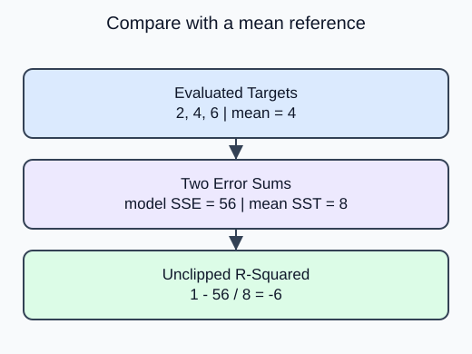

Compare prediction errors with the variation in the evaluated targets. Unlike MAE, this report has no dollar unit and can be negative.

`r2_score(actual, predicted)` compares the model squared-error sum with the squared-error sum of always predicting the evaluated target mean. A perfect model gives 1. Predicting that mean gives 0. A worse squared-error sum gives a negative value; clipping it to zero would hide useful evidence.

The mean reference here belongs to the mathematical denominator, not a fitted training baseline. A training-only `DummyRegressor` can predict a different mean on validation and need not score exactly zero there. Keep those two references distinct.

For a constant target the denominator vanishes. The default `force_finite=True` replaces non-finite perfect/imperfect results with 1 or 0. With `force_finite=False`, those constant-target cases remain NaN or negative infinity. Report that limitation rather than interpreting the replacement as ordinary explained variation. This lesson uses nonconstant targets.

Write $SSE=\sum_i(y_i-\hat y_i)^2$ and $SST=\sum_i(y_i-\bar y)^2$, where $\bar y$ is the evaluated target mean.

$$
R^2=1-\frac{SSE}{SST}.
$$

Targets $2,4,6$ have mean 4 and $SST=8$. Predictions $8,8,8$ give $SSE=56$:

$$
R^2=1-56/8=-6.
$$

Both sums use squared target units, so their ratio is unitless.

The corrected demo prints -6. The score reports a worse result than predicting the evaluated mean; it is not restricted to the interval zero to one.

## Your Tasks

1. Remove the lower bound of zero in `relative_fit` so it returns `r2_score` unchanged.

Edit `main.py`, press **Run** to inspect the supplied output, then **Submit** to check this task.
