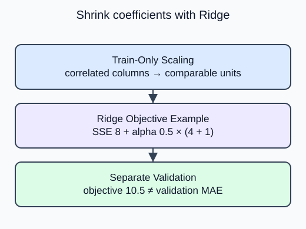

Two measurements can carry much of the same information. A linear model may then give them large, opposing coefficients that change noticeably with the training sample. Ridge adds a penalty on coefficient size; you will compare two penalty strengths on the same validation rows.

`Ridge(alpha=...)` fits a linear equation while penalizing squared coefficient size. Larger alpha puts more weight on that penalty. Scaling first matters: otherwise a coefficient attached to a large-unit feature can be numerically small simply because of its units.

## Dataset

`regression-measurements.csv` contains **90 fixed synthetic rows**. The supplied code reads the real CSV with `pd.read_csv`, then selects a feature DataFrame and a separate target Series. Keep those labeled pandas objects through splitting; estimators accept them directly. Each row is one independent synthetic measurement observation. These are dimensionless teaching measurements, not observed HomeHurray sales, prices or customer outcomes. No values are missing.

| Columns | Type / unit | Availability and role |
|---|---|---|
| feature_1, feature_2, feature_3 | float, dimensionless | measured before label assignment; predictors |
| target_value | float, arbitrary target units | assigned after features; target only |

The CSV row position preserves the original fixture order. It is not a predictor or entity ID. The supplied split uses that same row order and seed as the worked example. The target must never appear in X. `float_precision="round_trip"` preserves saved numeric precision; file loading is supplied setup, not another task.

## Worked explanation

The supplied CSV preserves a small generated numeric training problem. The helper returns a fitted `Pipeline` with steps named `scale` and `ridge`. The probe compares alpha 0.1 and 10 using validation MAE. Both candidates learn their own scaler from the same training partition; neither sees validation during fit. A lower validation error is a reason to select within this comparison, not a guarantee about the final test.

The default fitted intercept is not penalized. Ridge often shares weight among correlated features instead of forcing one coefficient exactly to zero. Inspecting a coefficient norm can describe shrinkage, but it does not measure business usefulness.

With residual sum $SSE$, coefficients $w_j$ and nonnegative penalty strength $\alpha$, Ridge minimizes

$$
SSE+\alpha\sum_j w_j^2.
$$

For an illustrative $SSE=8$, $w=(2,-1)$ and $\alpha=0.5$, the objective is

$$
8+0.5(4+1)=10.5.
$$

This is a training objective, not validation MAE. The intercept is outside the penalty.

Once the helper uses its argument, the two candidates need not make identical predictions. Compare their printed validation errors without touching test data.

## Your Tasks

1. Pass the helper argument `alpha` into `Ridge` instead of hardcoding 1.0.

Edit `main.py`, press **Run** to inspect the supplied output, then **Submit** to check this task.
