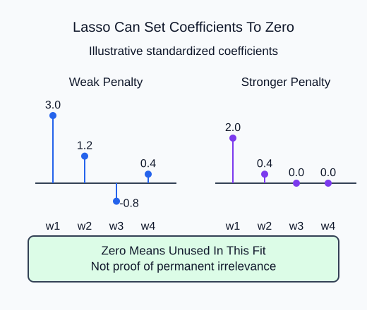

Fit a model that can assign some coefficients exactly zero, then inspect what that means for this particular training sample.

`Lasso` penalizes absolute coefficient sizes. Its fitted `coef_` may contain exact zeros, so the supplied probe prints the coefficient vector after scaling. The `alpha` value controls shrinkage; use the supplied argument rather than assuming the Ridge value has the same meaning.

## Dataset

`regression-measurements.csv` contains **90 fixed synthetic rows**. The supplied code reads the real CSV with `pd.read_csv`, then selects a feature DataFrame and a separate target Series. Keep those labeled pandas objects through splitting; estimators accept them directly. Each row is one independent synthetic measurement observation. These are dimensionless teaching measurements, not observed HomeHurray sales, prices or customer outcomes. No values are missing.

| Columns | Type / unit | Availability and role |
|---|---|---|
| feature_1, feature_2, feature_3, feature_4 | float, dimensionless | measured before label assignment; predictors |
| target_value | float, arbitrary target units | assigned after features; target only |

The CSV row position preserves the original fixture order. It is not a predictor or entity ID. The supplied split uses that same row order and seed as the worked example. The target must never appear in X. `float_precision="round_trip"` preserves saved numeric precision; file loading is supplied setup, not another task.

## Worked explanation

Scikit-learn normalizes the Lasso squared-error term by twice the number of training rows. Ridge uses an unnormalized squared-error sum. Consequently, the numeric alpha values are not directly comparable between the two estimators. Their default intercepts are not penalized.

A zero coefficient says that this fit did not use that scaled feature under this penalty. It does not prove the feature is irrelevant, and correlated inputs may substitute for one another. Scaling belongs inside the training-fitted pipeline. The probe reports coefficients and validation MAE, not a promised selected feature set. `max_iter=5000` and a tighter tolerance allow this small coordinate-descent fit to settle without turning iteration count into the lesson task.

Lasso minimizes the following objective, with $n$ training rows:

$$
\frac{SSE}{2n}+\alpha\sum_j |w_j|.
$$

For $SSE=8$, $n=4$, $w=(2,-1)$ and $\alpha=0.5$:

$$
8/(2\cdot4)+0.5(2+1)=2.5.
$$

Here $w_j$ denotes a feature coefficient; the intercept is excluded.

The returned estimator now records alpha 2. The printed coefficients describe this fit; do not use their zero count as an acceptance target.

## Your Tasks

1. Replace the fixed Lasso alpha with the supplied `alpha` argument in `fit_lasso`.

Edit `main.py`, press **Run** to inspect the supplied output, then **Submit** to check this task.
