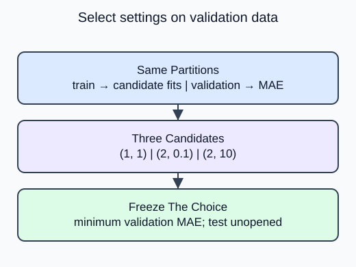

Choose between a short list of degree and alpha settings without letting final test results influence the choice.

Each candidate is a fresh pipeline: polynomial expansion, scaling and Ridge. Fit it on training rows, predict the same validation rows, and record validation MAE. Choosing the minimum of those errors is a model-selection step. The candidates must not share a transformer fitted on all data.

The helper accepts only training and validation inputs. Test labels are deliberately absent from its signature. Return the selected `(degree, alpha)` pair along with the error array in candidate order. For an exact tie, `np.argmin` picks the first candidate; that deterministic rule avoids a hidden second selection criterion.

The supplied list has only three candidates. Trying many alternatives against a tiny validation set can adapt to its noise, so do not treat a small winning margin as strong evidence. Once a choice is frozen, a later stage may refit it on development rows and report final test error. It must not return to this loop after seeing test results.

The error array does not change when you fix the selection direction. Only the chosen pair changes from the worst candidate to the best on validation.

## Your Tasks

1. Select the candidate with minimum rather than maximum validation MAE in `select_settings`.

Edit `main.py`, press **Run** to inspect the supplied output, then **Submit** to check this task.
