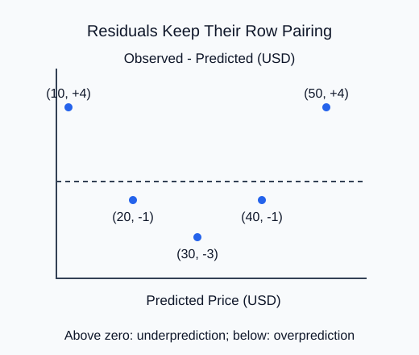

A single error score can hide a systematic pattern. Plot validation residuals against predictions before deciding that a regression is adequate.

Put predicted values on the horizontal axis and observed-minus-predicted residuals on the vertical axis. The zero line separates underprediction above it from overprediction below it. Every plotted point must preserve its row pairing.

The supplied example has positive residuals at both ends and negative residuals in the middle. That curved pattern suggests the fitted relationship misses structure. It is not a causal diagnosis, and a plot of a few synthetic rows cannot establish what a real pricing system needs. It tells you what to investigate with training and validation data.

Your helper returns the figure and axes so the supplied probe can label and display the result. Use one scatter collection and `ax.axhline(0, ...)` for a reference. The task fixes the residual direction; chart styling and a short interpretation are supplied rather than added as independent requirements. Do not use the sealed test plot to repeatedly redesign the model.

After the edit, the two ends appear above zero and the middle falls below it. The plot now matches the printed residual vector.

## Your Tasks

1. Correct the scatter y-values to observed minus predicted in `residual_plot`.

Edit `main.py`, press **Run** to inspect the supplied output, then **Submit** to check this task.
