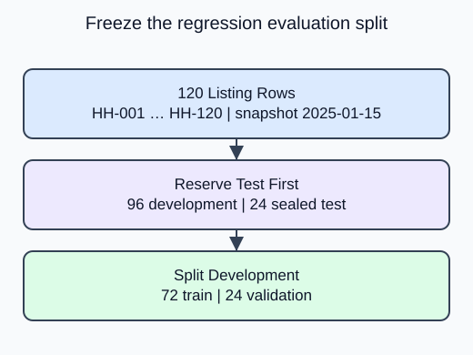

The first project brings your split, baseline, preprocessing, and regression work together. Begin by deciding which rows each stage may use. Once those memberships are fixed, later comparisons can share the same training, validation, and test data.

This first project stage estimates synthetic listing prices for HomeHurray Inc. It does not optimize a price or estimate demand. The upcoming exercise uses 120 independent products at a single 2025-01-15 snapshot; this demo uses a separate 20-row parcel table. Random splitting tests same-population generalization; it provides no evidence about a future catalog period.

## Dataset

The read-only `sample-parcels.csv` tab contains the real input file. `make_data()` reads that file with `pd.read_csv`; it does not generate replacement rows. Each Run starts from the authored snapshot. Empty numeric cells mean unrecorded measurements, not zero.

| Column | Type / unit | Available | Role |
|---|---|---|---|
| product_id | unique string | before listing | audit only |
| snapshot_date | ISO date, 2025-01-15 | before listing | provenance only |
| weight_kg | positive float, kg; missing allowed | before listing | predictor |
| volume_l | positive float, liters; missing allowed | before listing | predictor |
| material_cost_usd | positive float, USD; complete | before listing | predictor |
| listed_price_usd | positive float, USD; complete | after feature snapshot | target, never X |

The project uses 120 fixed product rows; demos use a separate 20-row parcel analogue. Both are synthetic. File loading is supplied setup rather than a second assessed task. `float_precision="round_trip"` preserves the saved numeric precision.

## Worked explanation

Reserve the test partition first. The remaining development rows contain both training and validation. Taking one quarter of that development partition leaves the desired 60/20/20 overall split. Use the same seed in both calls and preserve row order returned by the splitter. Splitting on the full table keeps IDs, features and targets aligned; later stages select only the three named predictor columns.

`product_id` and `snapshot_date` remain audit fields. Neither enters X. The target is `listed_price_usd`; missing values occur only in weight and volume, and they were injected after synthetic targets were generated. The supplied `make_data` reads the frozen CSV; it is not a prediction function. Learn predictions only from the permitted training rows.

The editable demo uses **20 synthetic sample parcels**, a separate analogue with the same column contract. Its split is 12 training, 4 validation and 4 test rows. The project-size diagram shows the upcoming 120-product transfer exercise, not the editor fixture.

The figure shows the upcoming exercise. With $n=120$ rows, test gets $0.2n=24$. Development has $96$ rows. Validation receives $0.25\cdot96=24$, leaving $72$ for training. The 0.25 fraction is relative to development, not the original table.

## Your Tasks

1. Change the second split fraction from 0.5 to 0.25 so validation receives one quarter of development, not half.

Edit `main.py`, press **Run** to inspect the supplied output, then **Submit** to check this task.
