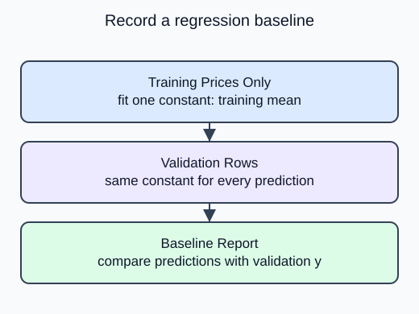

Add a reference error that a feature-based model must be compared with fairly.

The mean baseline predicts one number for every validation row: the training target mean. `DummyRegressor(strategy="mean")` still expects X during fit and prediction, but it ignores feature values. Supplied zero arrays have the required row counts and avoid involving missing measurements before imputation is introduced.

## Dataset

The read-only `sample-parcels.csv` tab contains the real input file. `make_data()` reads that file with `pd.read_csv`; it does not generate replacement rows. Each Run starts from the authored snapshot. Empty numeric cells mean unrecorded measurements, not zero.

| Column | Type / unit | Available | Role |
|---|---|---|---|
| product_id | unique string | before listing | audit only |
| snapshot_date | ISO date, 2025-01-15 | before listing | provenance only |
| weight_kg | positive float, kg; missing allowed | before listing | predictor |
| volume_l | positive float, liters; missing allowed | before listing | predictor |
| material_cost_usd | positive float, USD; complete | before listing | predictor |
| listed_price_usd | positive float, USD; complete | after feature snapshot | target, never X |

The project uses 120 fixed product rows; demos use a separate 20-row parcel analogue. Both are synthetic. File loading is supplied setup rather than a second assessed task. `float_precision="round_trip"` preserves the saved numeric precision.

## Worked explanation

Validation targets are used only to calculate the error after prediction. If you compute the constant from validation prices, the supposedly held-out reference has already learned from its answers. The next model must be evaluated on these same validation rows; changing the split would confound the comparison.

Keep the prior stage unchanged. Its saved membership contract is part of the experiment. This stage returns one MAE scalar and does not claim an improvement. A later model may or may not beat the baseline on these synthetic rows.

The editable demo uses **20 synthetic sample parcels**, a separate analogue with the same column contract. Its split is 12 training, 4 validation and 4 test rows. The project-size diagram shows the upcoming 120-product transfer exercise, not the editor fixture.

## Your Tasks

1. Fit the mean baseline with the training row count and training target column instead of the validation table.

Edit `main.py`, press **Run** to inspect the supplied output, then **Submit** to check this task.
