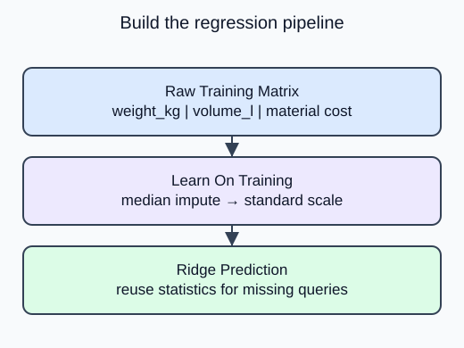

Replace the constant predictor with a train-fitted numeric pipeline that accepts incomplete raw measurements.

Select weight, volume and material cost in the fixed `FEATURES` order. Those three measurements are known before a listed price is assigned. The ID, snapshot date and target remain outside the predictor matrix. A model can memorize target leakage even when that leaked column looks like an ordinary number, so explicit selection matters.

## Dataset

The read-only `sample-parcels.csv` tab contains the real input file. `make_data()` reads that file with `pd.read_csv`; it does not generate replacement rows. Each Run starts from the authored snapshot. Empty numeric cells mean unrecorded measurements, not zero.

| Column | Type / unit | Available | Role |
|---|---|---|---|
| product_id | unique string | before listing | audit only |
| snapshot_date | ISO date, 2025-01-15 | before listing | provenance only |
| weight_kg | positive float, kg; missing allowed | before listing | predictor |
| volume_l | positive float, liters; missing allowed | before listing | predictor |
| material_cost_usd | positive float, USD; complete | before listing | predictor |
| listed_price_usd | positive float, USD; complete | after feature snapshot | target, never X |

The project uses 120 fixed product rows; demos use a separate 20-row parcel analogue. Both are synthetic. File loading is supplied setup rather than a second assessed task. `float_precision="round_trip"` preserves the saved numeric precision.

## Worked explanation

`SimpleImputer(strategy="median")` learns each column median from observed training entries. `StandardScaler` then learns statistics from the imputed training matrix. `Ridge` fits the resulting values. During prediction, the pipeline applies these saved transformations to validation or query rows without updating them.

The helper returns the fitted pipeline so later selection can call it repeatedly with different alphas. It does not silently concatenate validation rows. Each candidate will need a fresh object. The baseline and split helpers above are exactly the completed earlier stages; add this behavior without rewriting them.

The editable demo uses **20 synthetic sample parcels**, a separate analogue with the same column contract. Its split is 12 training, 4 validation and 4 test rows. The project-size diagram shows the upcoming 120-product transfer exercise, not the editor fixture.

## Your Tasks

1. Change the imputer strategy from mean to median in `build_model`.

Edit `main.py`, press **Run** to inspect the supplied output, then **Submit** to check this task.
