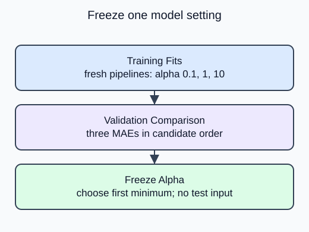

Freeze one alpha using the existing validation partition, while the test partition remains unopened.

The supplied candidate list is `[0.1, 1.0, 10.0]`. The earlier helper constructs a new pipeline on each call, so every candidate learns imputation and scaling from training only. Record one validation MAE per candidate in the same order as the list.

## Dataset

The read-only `sample-parcels.csv` tab contains the real input file. `make_data()` reads that file with `pd.read_csv`; it does not generate replacement rows. Each Run starts from the authored snapshot. Empty numeric cells mean unrecorded measurements, not zero.

| Column | Type / unit | Available | Role |
|---|---|---|---|
| product_id | unique string | before listing | audit only |
| snapshot_date | ISO date, 2025-01-15 | before listing | provenance only |
| weight_kg | positive float, kg; missing allowed | before listing | predictor |
| volume_l | positive float, liters; missing allowed | before listing | predictor |
| material_cost_usd | positive float, USD; complete | before listing | predictor |
| listed_price_usd | positive float, USD; complete | after feature snapshot | target, never X |

The project uses 120 fixed product rows; demos use a separate 20-row parcel analogue. Both are synthetic. File loading is supplied setup rather than a second assessed task. `float_precision="round_trip"` preserves the saved numeric precision.

## Worked explanation

Return both the winner and the error array. A number without its candidate association is hard to audit. An exact tie goes to the first listed alpha. No test argument belongs in this helper: changing sealed test targets must not change its return value.

The selected alpha is now a frozen setting. The next stage may refit it on training plus validation to use more development rows, but it cannot reconsider alpha from the final test score. The synthetic experiment has only a small validation partition, so a narrow error difference is uncertain rather than a proven business advantage.

The editable demo uses **20 synthetic sample parcels**, a separate analogue with the same column contract. Its split is 12 training, 4 validation and 4 test rows. The project-size diagram shows the upcoming 120-product transfer exercise, not the editor fixture.

## Your Tasks

1. Choose the minimum rather than maximum validation error in `choose_alpha`.

Edit `main.py`, press **Run** to inspect the supplied output, then **Submit** to check this task.
