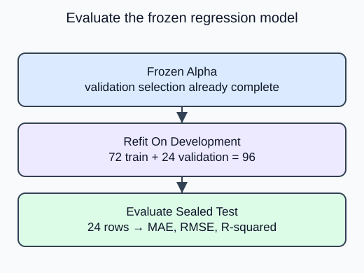

Use the frozen setting for one final evaluation and state exactly what the result measures.

Concatenate training then validation to form development. Refit a fresh pipeline with the selected alpha on those rows; this legitimately updates imputation and scaling because validation is no longer being used to select settings. The sealed test remains outside every fitted statistic.

## Dataset

The read-only `sample-parcels.csv` tab contains the real input file. `make_data()` reads that file with `pd.read_csv`; it does not generate replacement rows. Each Run starts from the authored snapshot. Empty numeric cells mean unrecorded measurements, not zero.

| Column | Type / unit | Available | Role |
|---|---|---|---|
| product_id | unique string | before listing | audit only |
| snapshot_date | ISO date, 2025-01-15 | before listing | provenance only |
| weight_kg | positive float, kg; missing allowed | before listing | predictor |
| volume_l | positive float, liters; missing allowed | before listing | predictor |
| material_cost_usd | positive float, USD; complete | before listing | predictor |
| listed_price_usd | positive float, USD; complete | after feature snapshot | target, never X |

The project uses 120 fixed product rows; demos use a separate 20-row parcel analogue. Both are synthetic. File loading is supplied setup rather than a second assessed task. `float_precision="round_trip"` preserves the saved numeric precision.

## Worked explanation

Return a dictionary with `model`, `alpha`, `development_ids`, `test_ids`, `n_development`, `n_test`, `predicted`, `mae`, `rmse`, and `r2`. Preserve test row order in both IDs and predictions. MAE and RMSE are in dollars; R-squared is unitless and may be negative. The supplied print loop excludes the model object and reports these fields without inventing a gain.

This is one deterministic teaching report, even if you rerun the code. Do not adjust alpha after reading it. The full exercise has 96 development and 24 test products; this demo has 16 development and 4 test parcels. Both fixtures come from a stationary synthetic population with independent rows, known pre-listing inputs and a simple target mechanism. The result does not establish optimal pricing, demand response, fairness, real commercial improvement or performance on future inventory.

The editable demo uses **20 synthetic sample parcels**, a separate analogue with the same column contract. Its split is 12 training, 4 validation and 4 test rows. The project-size diagram shows the upcoming 120-product transfer exercise, not the editor fixture.

The supplied output previews the completion report; the figure uses the full exercise counts. Save the selected setting and counts alongside its errors; do not infer a real-world gain from synthetic data.

## Your Tasks

1. Replace the training-only development table with `pd.concat([train, validation], axis=0)` before the final refit.

Edit `main.py`, press **Run** to inspect the supplied output, then **Submit** to check this task.
