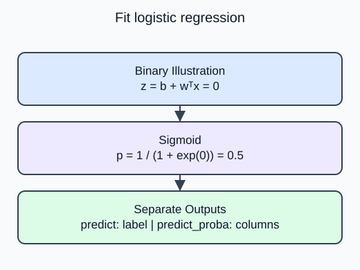

The price project predicted a number. Classification instead chooses a label, and a model may also report a probability for each possible label. Start with a small flower-species example so you can inspect the difference between those two outputs.

`LogisticRegression` is a classification estimator despite its name. The scaled pipeline learns a linear score for each class. `predict` returns one class label per query row, while `predict_proba` returns one column per class. Read `classes_` to identify those columns rather than assuming a probability is already a label.

The demo uses the bundled iris benchmark: four flower measurements in centimeters and three species labels. It is an external educational dataset, unrelated to HomeHurray Inc. The supplied stratified split preserves class representation while reserving query rows. Fit the scaler and classifier only on training rows. The probability rows sum to one, but normalization alone does not prove calibration or accuracy.

For two classes a sigmoid converts a linear score into a probability. Multiclass logistic regression uses a normalized multiclass rule rather than applying one independent binary threshold to every column. The task controls regularization through `C`, the inverse strength: smaller C means stronger regularization. `max_iter=1000` allows this small fit to converge; it is supplied setup.

For a binary linear score $z=b+w^Tx$, the positive-class probability is

$$
p=\frac{1}{1+e^{-z}}.
$$

At $z=0$, $p=1/(1+1)=0.5$. Here $b$ is the intercept and $w$ contains feature weights. This binary illustration is not a formula for the demo's entire three-class matrix.

The fitted model now records C 0.2. The printed probability rows still sum to one; use the displayed class order to interpret each column.

Dataset provenance: Iris is attributed to R. A. Fisher (UCI DOI 10.24432/C56C76); Wine to Stefan Aeberhard and M. Forina (UCI DOI 10.24432/C5PC7J). Their UCI records specify CC BY 4.0, separately from the scikit-learn software license. Both bundled tables are complete. Iris measurements are in centimeters; Wine constituent scales follow `data.DESCR` rather than invented units. These benchmarks are not company records.

## Your Tasks

1. Replace the hardcoded logistic-regression C with the `C` argument in `fit_classifier`.

Edit `main.py`, press **Run** to inspect the supplied output, then **Submit** to check this task.
