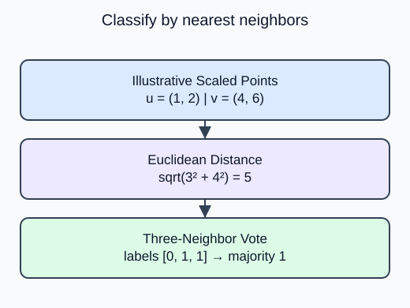

Predict a class by voting among nearby training rows rather than fitting a coefficient for each feature.

`KNeighborsClassifier(n_neighbors=k)` stores training examples and finds the k nearest ones at prediction time. With default uniform weights, each selected neighbor contributes one vote. The class with the largest vote count wins. Keep k no larger than the training row count.

Distances depend on units. A large-range feature can dominate a Euclidean distance, so the supplied pipeline fits `StandardScaler` on training only before storing the neighbor matrix. Query rows use that same scale. Changing query values must not cause a second scaler fit.

The iris demo and wine transfer use bundled educational benchmarks, not company data. Increasing k makes the vote include a larger neighborhood; it does not guarantee better held-out accuracy. The task uses k=3 so a designed binary neighborhood can have a clear majority. For multiclass ties, label ordering can affect the result, which is one reason not to assign meaning to incidental tie outcomes.

For scaled coordinate vectors $u,v$, Euclidean distance is

$$
d(u,v)=\sqrt{\sum_j(u_j-v_j)^2}.
$$

An illustrative pair $u=(1,2)$ and $v=(4,6)$ has

$$
d=\sqrt{3^2+4^2}=5.
$$

Compute neighbors in the scaled space, not by mixing raw measurement units.

The helper now stores three as its neighbor count. A nearest row with one label can lose to the other two neighbors; the hidden check exercises that case.

Dataset provenance: Iris is attributed to R. A. Fisher (UCI DOI 10.24432/C56C76); Wine to Stefan Aeberhard and M. Forina (UCI DOI 10.24432/C5PC7J). Their UCI records specify CC BY 4.0, separately from the scikit-learn software license. Both bundled tables are complete. Iris measurements are in centimeters; Wine constituent scales follow `data.DESCR` rather than invented units. These benchmarks are not company records.

## Your Tasks

1. Use the supplied `k` instead of 1 for the neighbor count in `fit_neighbors`.

Edit `main.py`, press **Run** to inspect the supplied output, then **Submit** to check this task.
