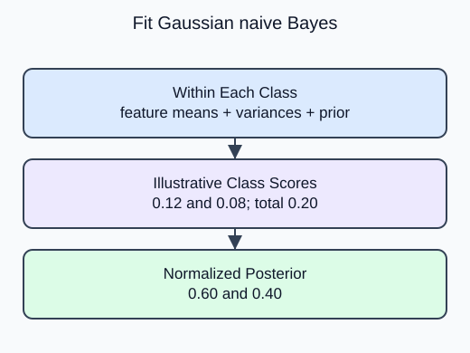

Estimate each class from simple class-specific feature distributions, then compare the resulting probabilities.

`GaussianNB` models each numeric feature with a Gaussian distribution within each class. `theta_` contains class-specific feature means; `var_` contains variances with a small numerical stabilizer. `class_prior_` stores the prior probabilities. Every row of these class-specific summaries follows `classes_` order.

The naive assumption is conditional independence: feature likelihoods multiply given the class. It does not say that features are unconditionally independent in the dataset. Correlated measurements can violate the assumption, and normalized probabilities can still be overconfident. Evaluate a useful baseline without treating its confidence as a guarantee.

The iris demo uses observed class frequencies by default in its unfinished version. The task changes it to the supplied explicit priors. That isolates how prior knowledge enters the classifier without changing its class-specific feature estimates. GaussianNB does not need an `n_jobs` argument and does not expose one. The transfer uses a different educational benchmark.

For class $c$ and feature vector $x$, the model uses

$$
P(c\mid x)\propto P(c)\prod_j p(x_j\mid c).
$$

$P(c)$ is the class prior, $p(x_j\mid c)$ a feature density, and the left side is the posterior class probability. Divide each class score by the sum of all class scores. Illustrative scores 0.12 and 0.08 normalize to $0.12/0.20=0.6$ and $0.08/0.20=0.4$. Densities are not individual-event probabilities.

The printed prior array now matches the supplied values rather than observed training proportions. Probability rows still normalize to one.

Dataset provenance: Iris is attributed to R. A. Fisher (UCI DOI 10.24432/C56C76); Wine to Stefan Aeberhard and M. Forina (UCI DOI 10.24432/C5PC7J). Their UCI records specify CC BY 4.0, separately from the scikit-learn software license. Both bundled tables are complete. Iris measurements are in centimeters; Wine constituent scales follow `data.DESCR` rather than invented units. These benchmarks are not company records.

## Your Tasks

1. Pass the supplied `priors` to `GaussianNB` in `fit_bayes` instead of using empirical priors.

Edit `main.py`, press **Run** to inspect the supplied output, then **Submit** to check this task.
