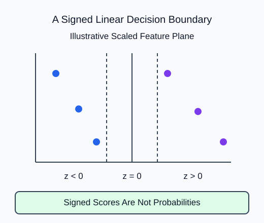

Use a signed decision score to classify synthetic rows without mislabeling that score as a probability.

`LinearSVC(dual="auto")` learns a linear separating rule. In a binary problem, `decision_function` returns one signed score per row. Negative scores select `classes_[0]`; positive scores select `classes_[1]`. Zero is the boundary, not a calibrated 50% probability statement.

## Dataset

`classification-measurements.csv` contains **90 fixed synthetic rows**. The supplied code reads the real CSV with `pd.read_csv`, then selects a feature DataFrame and a separate target Series. Keep those labeled pandas objects through splitting; estimators accept them directly. Each row is one independent synthetic measurement observation. These are dimensionless teaching measurements, not observed HomeHurray sales, prices or customer outcomes. No values are missing.

| Columns | Type / unit | Availability and role |
|---|---|---|
| feature_1, feature_2 | float, dimensionless | measured before label assignment; predictors |
| class_label | integer, classes 0 and 1 | assigned after features; target only |

The CSV row position preserves the original fixture order. It is not a predictor or entity ID. The supplied split uses that same row order and seed as the worked example. The target must never appear in X. `float_precision="round_trip"` preserves saved numeric precision; file loading is supplied setup, not another task.

## Worked explanation

`C` controls the tradeoff between a wider margin and training violations. A smaller C permits more violations in exchange for stronger regularization. Fit `StandardScaler` inside the pipeline so feature units do not dominate the margin geometry. `dual="auto"` lets the estimator choose a compatible optimization formulation for the matrix shape and loss.

The CSV was created with a fixed `make_classification` call: two informative numeric features, no redundant ones, and two synthetic classes. `class_sep` controls separation while `random_state` makes the draw reproducible. These dimensionless rows are a teaching example, not measured customer behavior. Unlike logistic regression, this estimator does not provide `predict_proba`. Never clip its scores to the interval zero to one and call them probabilities.

The binary signed score is $z=w^Tx+b$. For illustrative scaled input $x=(2,1)$, weights $w=(1,-2)$ and intercept $b=-1$:

$$
z=1(2)-2(1)-1=-1.
$$

The negative sign chooses the first class. The score itself is not a distance in the original measurement units or a probability.

The model now records C 0.2. Inspect signs alongside labels; do not expect every score to lie in a probability interval.

## Your Tasks

1. Use the supplied C in `LinearSVC` rather than the fixed value 1.0.

Edit `main.py`, press **Run** to inspect the supplied output, then **Submit** to check this task.
