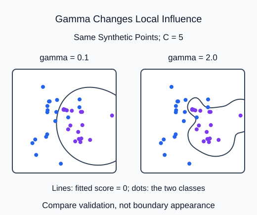

Compare two nonlinear SVM settings using validation labels, while keeping the fitted scaling confined to training.

`SVC(kernel="rbf")` can bend a decision boundary by comparing rows through a radial basis kernel. Gamma controls how quickly similarity decreases with squared distance. A larger gamma makes each training point's influence more local, which can create tightly bending boundaries. C controls the penalty for training violations. Neither parameter can be chosen reliably from a prettier training boundary.

## Dataset

`classification-measurements.csv` contains **100 fixed synthetic rows**. The supplied code reads the real CSV with `pd.read_csv`, then selects a feature DataFrame and a separate target Series. Keep those labeled pandas objects through splitting; estimators accept them directly. Each row is one independent synthetic measurement observation. These are dimensionless teaching measurements, not observed HomeHurray sales, prices or customer outcomes. No values are missing.

| Columns | Type / unit | Availability and role |
|---|---|---|
| feature_1, feature_2 | float, dimensionless | measured before label assignment; predictors |
| class_label | integer, classes 0 and 1 | assigned after features; target only |

The CSV row position preserves the original fixture order. It is not a predictor or entity ID. The supplied split uses that same row order and seed as the worked example. The target must never appear in X. `float_precision="round_trip"` preserves saved numeric precision; file loading is supplied setup, not another task.

## Worked explanation

The supplied helper evaluates a short list of `(C, gamma)` pairs. Each candidate is a fresh scaled pipeline fitted only on training rows. Its `.score(validation, actual)` is classification accuracy for these labeled validation rows. Return the best pair and the score array in candidate order; ties go to the first pair. Accuracy is used only for this small balanced illustration, not as a universal classification metric.

The generated two-feature data use two clusters per class to make a single linear boundary less suitable. RBF can represent more flexible relationships, but it may still lose on unseen rows. Keep test data outside the helper and do not enable probability estimation simply to get labels; ordinary `predict` already provides them.

The candidate score array now comes from nonlinear RBF models. A difference from the linear version is evidence about this validation fixture, not a promised improvement on test.

## Your Tasks

1. Switch the supplied candidate pipelines from a linear kernel to `kernel="rbf"` in `select_rbf`.

Edit `main.py`, press **Run** to inspect the supplied output, then **Submit** to check this task.
