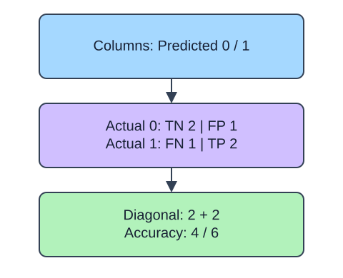

A list of predicted return flags does not show which mistakes a model made. Compare it with the observed outcomes in a confusion matrix. Rows are actual classes and columns are predicted classes. Pass `labels=[negative, positive]` explicitly so the positive outcome means what you intended, rather than relying on alphabetical order.

## Dataset

`observations.csv` contains 90 original synthetic HomeHurray Inc. observations. One independent synthetic measurement observation per row. These are teaching data, not actual company performance.

| Column | Meaning and type / unit | Availability / role |
|---|---|---|
| `observation_id` | Unique string observation ID | Audit metadata, excluded from X |
| `measurement_a` | Float synthetic measurement, arbitrary signed units | Available before the synthetic outcome; feature |
| `measurement_b` | Float synthetic measurement, arbitrary signed units | Available before the synthetic outcome; feature |
| `measurement_c` | Float synthetic measurement, arbitrary signed units | Available before the synthetic outcome; feature |
| `truth` | Integer 0/1 synthetic outcome; 1 is positive | Observed label used for metric arithmetic |
| `predicted` | Fabricated integer 0/1 decision | Supplied prediction, not an input feature |
| `score` | Fabricated float in [0, 1], larger favors class 1 | Supplied score, not an input feature |

All stored values are complete. The fixed observation snapshot is 2025-01-15. The values retain their original seeded-fixture order and precision. Decisions and scores were deliberately fabricated from labels to practice metrics; they are not independent fitted-model evaluation. Figures use separate tiny illustrative counts.

The supplied setup reads the real read-only CSV tab with `pd.read_csv(..., float_precision="round_trip")` and retains pandas tables until the metric, split, or estimator operation. Data loading is supplied; edit only `main.py` for the task. The complete maintainer dictionary is stored beside the lesson in `data-dictionary.md`.

The four cells are true negatives (TN), false positives (FP), false negatives (FN), and true positives (TP), read row by row. The diagonal counts correct decisions. Accuracy can look high when almost every order belongs to one class, so retain the matrix alongside it.

## A small calculation

$$
\mathrm{accuracy}=\frac{TP+TN}{n}
$$

Here $n$ is the number of observations. For the six-row illustration, $(2+2)/6=0.6667$ (rounded).

## Your Tasks

1. In `summarize`, change `labels=labels[::-1]` to `labels=labels`.

Edit `main.py`, press Run to inspect the supplied checkpoint, then Submit. The initial demo runs but its setting does not yet meet the task. After the edit, compare the checkpoint with the original run.
