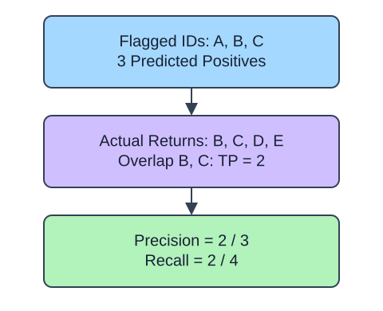

Precision asks how many flagged orders actually returned. Recall asks how many observed returns were flagged. These denominators answer different questions: adding false alarms changes precision; missing returns changes recall. `pos_label` selects the outcome of interest even when labels are strings.

## Dataset

`observations.csv` contains 90 original synthetic HomeHurray Inc. observations. One independent synthetic measurement observation per row. These are teaching data, not actual company performance.

| Column | Meaning and type / unit | Availability / role |
|---|---|---|
| `observation_id` | Unique string observation ID | Audit metadata, excluded from X |
| `measurement_a` | Float synthetic measurement, arbitrary signed units | Available before the synthetic outcome; feature |
| `measurement_b` | Float synthetic measurement, arbitrary signed units | Available before the synthetic outcome; feature |
| `measurement_c` | Float synthetic measurement, arbitrary signed units | Available before the synthetic outcome; feature |
| `truth` | Integer 0/1 synthetic outcome; 1 is positive | Observed label used for metric arithmetic |
| `predicted` | Fabricated integer 0/1 decision | Supplied prediction, not an input feature |
| `score` | Fabricated float in [0, 1], larger favors class 1 | Supplied score, not an input feature |

All stored values are complete. The fixed observation snapshot is 2025-01-15. The values retain their original seeded-fixture order and precision. Decisions and scores were deliberately fabricated from labels to practice metrics; they are not independent fitted-model evaluation. Figures use separate tiny illustrative counts.

The supplied setup reads the real read-only CSV tab with `pd.read_csv(..., float_precision="round_trip")` and retains pandas tables until the metric, split, or estimator operation. Data loading is supplied; edit only `main.py` for the task. The complete maintainer dictionary is stored beside the lesson in `data-dictionary.md`.

If there are no positive predictions, precision has a zero denominator. Use `zero_division=0` as an explicit reporting policy rather than claiming perfect precision. The same policy applies to recall when there are no actual positives. Always keep the relevant counts when interpreting this edge case.

## A small calculation

$$
P=\frac{TP}{TP+FP},\qquad R=\frac{TP}{TP+FN}
$$

$TP$ counts true positives, $FP$ false positives, and $FN$ false negatives.

$P$ is precision and $R$ is recall. For $TP=2$, $FP=1$, $FN=2$, $P=0.6667$ and $R=0.5$.

The supplied additional checkpoint exposes the changed policy even when the main fixture produces the same prediction. It is a probe, not another task.

## Your Tasks

1. In `measure`, change `policy = 1` to `policy = 0`.

Edit `main.py`, press Run to inspect the supplied checkpoint, then Submit. The initial demo runs but its setting does not yet meet the task. After the edit, compare the checkpoint with the original run.
