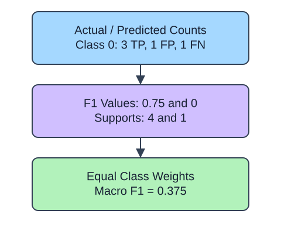

F1 combines precision and recall for one class. Macro F1 then gives each listed class the same weight, regardless of how frequent it is. A rare return class therefore contributes as much as the common no-return class. Weighted F1 instead weights class scores by support.

Use `average=None` to inspect one F1 per class before taking their mean. Support is the number of actual rows of each class, not the number predicted. A mean without those counts conceals whether a class has two examples or two hundred. The supplied zero policy reports undefined class F1 as zero.

The demo uses the bundled iris labels; the exercise uses wine labels. `target_names` describes each integer class. These are external educational benchmarks, unrelated to HomeHurray Inc. Predictions are deliberately perturbed copies of labels for metric practice, not fitted-model quality evidence. Consult each Bunch `DESCR` for dataset provenance and license; dataset terms are separate from the scikit-learn software license.

## A small calculation

$$
F_1=\frac{2PR}{P+R}
$$

$F_{1,k}$ is the F1 score for class $k$.

$P$ and $R$ are precision and recall for one class. For $K$ classes, macro F1 is $\frac{1}{K}\sum_{k=1}^{K}F_{1,k}$. Scores $0.75$ and $0$ give $(0.75+0)/2=0.375$, regardless of support.

## Data used here

These are bundled external benchmark observations, not company records. The fabricated predictions in the F1 lesson are only arithmetic fixtures. No external dataset is fetched.

| Field | Type / domain | Missing | Available | Role |
|---|---|---|---|---|
| `truth` | integer class IDs 0, 1, 2 from bundled iris or wine | none | labeled benchmark observation | target |
| `predicted` | fabricated class IDs in the same domain | none | supplied metric demonstration | synthetic predictions |
| `labels` | ordered integer IDs corresponding to `dataset.target_names` | none | dataset metadata | reporting order |

Iris has 150 labeled flower observations; wine has 178 chemical-analysis observations. No benchmark table is redistributed in this lesson.

## Your Tasks

1. In `class_report`, change `average = 'weighted'` to `average = None`.

Edit `main.py`, press Run to inspect the supplied checkpoint, then Submit. The initial demo runs but its setting does not yet meet the task. After the edit, compare the checkpoint with the original run.
