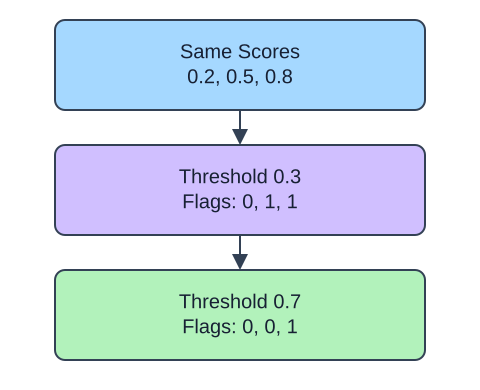

A probability score becomes a flag only after a threshold is chosen. The rule here is `score >= threshold`, so a score exactly on the boundary is positive. Lower thresholds generally flag more orders, but the precision change is not guaranteed to be monotonic.

## Dataset

`observations.csv` contains 90 original synthetic HomeHurray Inc. observations. One independent synthetic measurement observation per row. These are teaching data, not actual company performance.

| Column | Meaning and type / unit | Availability / role |
|---|---|---|
| `observation_id` | Unique string observation ID | Audit metadata, excluded from X |
| `measurement_a` | Float synthetic measurement, arbitrary signed units | Available before the synthetic outcome; feature |
| `measurement_b` | Float synthetic measurement, arbitrary signed units | Available before the synthetic outcome; feature |
| `measurement_c` | Float synthetic measurement, arbitrary signed units | Available before the synthetic outcome; feature |
| `truth` | Integer 0/1 synthetic outcome; 1 is positive | Observed label used for metric arithmetic |
| `predicted` | Fabricated integer 0/1 decision | Supplied prediction, not an input feature |
| `score` | Fabricated float in [0, 1], larger favors class 1 | Supplied score, not an input feature |

All stored values are complete. The fixed observation snapshot is 2025-01-15. The values retain their original seeded-fixture order and precision. Decisions and scores were deliberately fabricated from labels to practice metrics; they are not independent fitted-model evaluation. Figures use separate tiny illustrative counts.

The supplied setup reads the real read-only CSV tab with `pd.read_csv(..., float_precision="round_trip")` and retains pandas tables until the metric, split, or estimator operation. Data loading is supplied; edit only `main.py` for the task. The complete maintainer dictionary is stored beside the lesson in `data-dictionary.md`.

Use only reserved validation labels to compare 0.3, 0.5, and 0.7. Among candidates with recall at least 0.75, choose the highest precision, then the highest threshold. If none meets the constraint, choose highest recall, then precision, then the lowest threshold. These tie rules make the policy reproducible. Freeze both the fitted scoring model and this threshold before opening the final test set; refitting would change the scores.

The supplied additional checkpoint exposes the changed policy even when the main fixture produces the same prediction. It is a probe, not another task.

## Your Tasks

1. In `choose_threshold`, change `np.asarray(scores) > threshold` to `np.asarray(scores) >= threshold`.

Edit `main.py`, press Run to inspect the supplied checkpoint, then Submit. The initial demo runs but its setting does not yet meet the task. After the edit, compare the checkpoint with the original run.
